<p align="center">
  
</p>

<h1 align="center">AeroGuard - Avionics Health Monitoring Simulator</h1>

<p align="center">
  A deterministic C++20 simulator with an ASP.NET Core REST and SignalR API, SQLite access control, and a React world-map dashboard.
</p>

<p align="center">
  
  
  
  
  
  
  
</p>

> AeroGuard is independent educational software. It uses fictional components
> and synthetic data. It doesn't reproduce proprietary systems, control
> equipment, implement weapons or countermeasures, claim hard real-time
> guarantees, or claim aviation certification.

Repository: [github.com/dzikidziklasrwie/AeroGuard](https://github.com/dzikidziklasrwie/AeroGuard)

## What this project shows

| Engineering concern | Implementation choice |
|---|---|
| Predictable simulation | Seeded generation, virtual milliseconds, configurable tick and duration |
| Typed domain model | `std::variant` telemetry payloads and scoped subsystem/health/state enums |
| Bounded communication | Fixed-capacity queue with explicit full, empty, timeout, and close behaviour |
| Fault handling | Validation, heartbeat timeout, subsystem isolation, and a five-state transition policy |
| Testability | Injected clock and simulated hardware boundary, GoogleTest unit/integration suite |
| Inspectable diagnostics | Schema-versioned JSONL with metadata, telemetry, events, transitions, and summary |
| Queryable archive | ASP.NET Core Minimal API validates JSONL and imports unchanged replay bytes and ordered records into SQLite |
| Access control | Revocable opaque sessions, roles, aircraft assignments, per-account operation permissions, protected invariants, and audit records |
| Simulated operations | Packaged Natural Earth map, destination-based continent routes, route phase/progress, role-aware chat, and session-checked SignalR updates |
| Map interaction | Validated coordinates, bounded transit and patrol, last-valid-position recovery, sphere-clipped markers, 1x-6x zoom, pan, reset, and selected-aircraft focus |
| Scenario-linked map effects | Each flight keeps a visible identity, ground shadow, selected-aircraft card, and deterministic visuals derived from its stored telemetry timeline |
| UI separation | React reads stored C++ output through REST or a static fallback; it doesn't recreate thresholds or state transitions |
| Work reduction | Idle broadcasts stop before database reads, flight data is prepared once per update, replay state is derived in one pass, and the map module loads on demand |
| Delivery | CMake presets, Windows/Linux CI, xUnit, clang-tidy, ASan/UBSan, Dependabot, and multi-stage Docker |

```mermaid
flowchart LR
    A[Scenario + seed] --> B[C++ virtual-time simulator]
    B --> C[Typed telemetry]
    C --> D[Validation + heartbeat monitor]
    D --> E[Health state machine]
    E --> F[(JSONL replay)]
    F --> G[Validated importer]
    G --> H[(SQLite)]
    H --> I[ASP.NET Core REST API]
    I -->|REST archive + snapshots| J[React dashboard]
    I -->|SignalR flight updates| J
```



## Dashboard preview

<p align="center">
  
</p>

This is a browser capture of the production Docker image replaying JSONL
generated by the C++ simulator. It is not a design mock-up.

### Simulated operations map

<p align="center">
  
</p>

This authenticated browser capture shows three API-backed aircraft, packaged
world geometry, role-aware controls, and stored C++ telemetry delivered through
the integrated Docker stack.

## Verification snapshot

Observed locally on 2026-11-21:

| Check | Result |
|---|---|
| Current native feature suite | 45/45 CTest checks passed, including all seven 40-to-105-second scenarios |
| ASP.NET Core / SQLite | 67/67 xUnit test cases passed |
| React / TypeScript | `npm ci`, lint, typecheck, 47/47 Vitest tests in 10 files, and production build passed |
| Dependency audit | 0 known npm vulnerabilities reported |
| Current Docker/browser path | API and dashboard images built; Compose reported both services healthy; Chrome completed the nginx WebSocket handshake and received four SignalR frames |
| Current implementation revision | GitHub Actions passed MSVC, GCC, ASan/UBSan, clang-tidy, frontend, API, and Docker jobs |

GitHub Actions run
[`44854113152`](https://github.com/dzikidziklasrwie/AeroGuard/actions/runs/44854113152)
passed all seven jobs on implementation commit `47d38c5`, including the
destination routing, viewport, per-aircraft scenario, and work-reduction
changes described here. The automated suites
negotiate SignalR but don't connect a real WebSocket client end to end; the
browser, nginx WebSocket, and Docker network path passed a separate local
check. We don't claim a coverage percentage. The process-local connection
registry and per-recipient authorization target a small single-instance
demonstration, not a distributed or high-volume fleet. [TASKS.md](TASKS.md)
records the command evidence.

## Run the demo

Docker is the shortest path. Copy the environment template and replace the
administrator password first. The build compiles the C++ producer, generates
all seven replays, publishes the API, builds React, and starts the integrated
stack:

```bash
cp .env.example .env
docker compose up --build
```

Open [http://localhost:8080](http://localhost:8080). The `Public replay scenario`
selector covers
normal operation, communications loss, bad sensor data, overheating, power
fluctuation, multiple failures, and temporary-fault recovery. The selected run
plays automatically and loops until another run is chosen. Sign in to the
operations workspace to manage accounts, roles, aircraft, assignments, and
audit records. The signed-in workspace opens on a simulated world map with
assigned flights, stored C++ telemetry, flight chat, and authorized controls.
Account roles and aircraft assignments are separate: `Operator`, `Maintainer`,
and `Viewer` define account capabilities, while `OWNER`, `MAINTAINER`, and
`VIEWER` define access to a specific aircraft. Only an administrator can assign
an existing aircraft to another account or change that assignment.
Fleet presents these access levels as `Operator`, `Maintainer`, and `Viewer`
so they match People and roles; the Operator choice maps to the API's `OWNER`
level. Selecting an account proposes the matching Fleet role automatically.
Coordinates define a route's start. A continent selection defines its
destination: the marker follows a great-circle `TRANSIT` for at most 30 seconds,
then enters a bounded `PATROL`. The map supports zoom, pan, reset, and focus on
the selected aircraft. Country routes use bounded catalog profiles plus a
local fallback; they don't claim political-border containment.
Every marker links a map-position shadow to its aircraft silhouette and keeps
the tail number visible. A selected-aircraft card repeats the tail number,
display name, assigned scenario, and active effect. Communication loss adds
signal rings, invalid sensor data adds an amber alert, power fluctuation adds
electrical arcs, simultaneous failures add smoke and fault pulses, and recovery
adds a green ring. The 105-second overheating replay shows sustained heat,
fire from 60 to 80 seconds, airframe breakup, descending debris, and impact.
Land receives an impact burst and wreckage; water receives a splash and
floating debris without a second explosion. The route holds at the breakup
point until that replay cycle restarts. These are fictional presentation
effects, not a physical crash or flight-dynamics model.
Compose synchronizes the configured administrator password at API startup, so
editing `.env` and recreating the API container updates that login and revokes
its older sessions. Changing the public replay selector keeps an authenticated
Operations Workspace mounted and doesn't discard its in-memory session.

To change one aircraft's scenario, sign in, open the map, select the aircraft
by its marker or flight-board row, choose a run under `Change scenario for
<tail number>`, and select `Apply scenario`. This control changes only the
selected aircraft; its destination and patrol area stay unchanged.

For a native debug build:

```bash
cmake --preset debug
cmake --build --preset debug
ctest --preset debug --output-on-failure
cmake -E make_directory demo-output
./build/debug/aeroguard --scenario simulated-overheating --seed 42 --output demo-output/overheating.jsonl
```

On Windows, run the same preset commands in Developer PowerShell and invoke
`.\build\debug\aeroguard.exe`. See the [project guide](docs/PROJECT-GUIDE.md#build-and-run-from-source)
for prerequisites, frontend commands, install steps, sanitizers, and troubleshooting.

## Supplied scenarios

| Scenario slug | Duration | Injected condition | Expected result |
|---|---:|---|---|
| `normal-operation` | 40 s | None | Startup reaches normal health and remains stable. |
| `communication-interruption` | 45 s | Missing communications telemetry | Heartbeat loss is detected while other subsystems keep reporting. |
| `invalid-sensor-data` | 45 s | Invalid temperature sample | Validation records the rejected reading and its health effect. |
| `simulated-overheating` | 105 s | Sustained thermal fault | Temperature health remains in fault while the map progresses through heat, fire, breakup, debris, and impact phases. |
| `power-fluctuations` | 45 s | Voltage/frequency variation | Power quality crosses health thresholds. |
| `multiple-subsystem-failures` | 55 s | Concurrent injected faults | Aggregate state reflects compounded subsystem failures. |
| `recovery-after-temporary-failure` | 45 s | Time-bounded fault | Health passes through `RECOVERY` before a steady state. |

List or export them from the executable:

```bash
./build/debug/aeroguard --list-scenarios
./build/debug/aeroguard --export-all frontend/public/data --scenarios-dir scenarios --seed 42
```

## Output contract

The first JSONL record describes the run. Telemetry, events, and accepted state
transitions follow in virtual-time order. A summary closes the file.

```json
{"schema_version":1,"record_type":"state_transition","timestamp_ms":2500,"from":"NORMAL","to":"FAULT","reason":"One or more subsystems reported a fault","severity":"CRITICAL"}
```

`manifest.json` indexes the generated files for the dashboard. Use the same
scenario, seed, duration, and tick interval to replay the same ordered records.

## Repository map

```text
include/aeroguard/   Public C++ types and component interfaces
src/core/            Telemetry validation and state policy
src/diagnostics/     Aggregate health and heartbeat monitoring
src/hal/             Simulated hardware abstraction
src/simulation/      Scenario parsing, subsystem models, and engine
src/logging/         JSONL producer
tests/               GoogleTest unit and integration tests
frontend/            React, TypeScript, Vite, and Vitest dashboard
backend/             ASP.NET Core Minimal API, SQLite schema, and xUnit tests
deploy/              nginx configuration for the integrated Docker stack
scenarios/           Seven fictional fault-injection definitions
docs/                One project guide plus portfolio images
```

## Documentation

[AeroGuard project guide](docs/PROJECT-GUIDE.md) is the single detailed
document. It contains the user manual, build instructions, architecture,
telemetry and state contracts, security rules, requirements, test evidence,
design decisions, `REQ-001` through `REQ-058`, limitations, CV wording,
interview notes, and image
provenance. [TASKS.md](TASKS.md) retains the command-level completion record.

## License

[MIT](LICENSE). Contributions must stay inside the fictional educational scope
described in [CONTRIBUTING.md](CONTRIBUTING.md).
