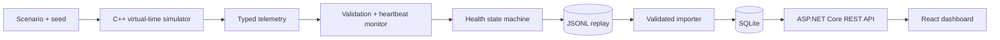

<p align="center">
  
</p>

<h1 align="center">AeroGuard - Avionics Health Monitoring Simulator</h1>

<p align="center">
  A deterministic C++20 simulator with an ASP.NET Core REST archive, SQLite access control, and a React operations dashboard.
</p>

<p align="center">
  
  
  
  
  
  
  
</p>

> AeroGuard is independent educational software. It uses fictional components
> and synthetic data. It doesn't reproduce proprietary systems, control
> equipment, implement weapons or countermeasures, claim hard real-time
> guarantees, or claim aviation certification.

Repository: [github.com/dzikidziklasrwie/AeroGuard](https://github.com/dzikidziklasrwie/AeroGuard)

## What this project shows

| Engineering concern | Implementation choice |
|---|---|
| Predictable simulation | Seeded generation, virtual milliseconds, configurable tick and duration |
| Typed domain model | `std::variant` telemetry payloads and scoped subsystem/health/state enums |
| Bounded communication | Fixed-capacity queue with explicit full, empty, timeout, and close behaviour |
| Fault handling | Validation, heartbeat timeout, subsystem isolation, and a five-state transition policy |
| Testability | Injected clock and simulated hardware boundary, GoogleTest unit/integration suite |
| Inspectable diagnostics | Schema-versioned JSONL with metadata, telemetry, events, transitions, and summary |
| Queryable archive | ASP.NET Core Minimal API validates JSONL and imports unchanged replay bytes and ordered records into SQLite |
| Access control | Revocable opaque sessions, built-in and custom roles, aircraft assignments, protected invariants, and audit records |
| UI separation | React reads C++ output through REST or a static fallback; it doesn't recreate health decisions |
| Delivery | CMake presets, Windows/Linux CI, xUnit, clang-tidy, ASan/UBSan, Dependabot, and multi-stage Docker |



## Dashboard preview

<p align="center">
  
</p>

This is a browser capture of the production Docker image replaying JSONL
generated by the C++ simulator. It is not a design mock-up.

## Verification snapshot

Observed locally on 2026-11-19:

| Check | Result |
|---|---|
| Windows / MSVC 19.51, strict warnings | Clean build; 44/44 CTest tests passed |
| Ubuntu 24.04 / GCC 13.3, `-Werror` | Clean container build; 44/44 CTest tests passed |
| GCC 13.3 / ASan + UBSan | 44/44 CTest tests passed |
| Clang 18.1 / clang-tidy | Analysis build completed |
| ASP.NET Core / SQLite | Release build and 31/31 xUnit integration tests passed; format verification reported no changes |
| React / TypeScript | `npm ci`, lint, typecheck, 25/25 Vitest tests in 7 files, and production build passed |
| Dependency audit | 0 known npm vulnerabilities reported |
| Docker API | Non-root image built; archive reported seven runs and administrator login succeeded |
| Docker stack | API, SQLite volume, nginx proxy, and dashboard smoke check described in `TASKS.md` |

The repository includes a GitHub Actions workflow, but no hosted runner has
completed it yet. We don't claim a coverage percentage. [TASKS.md](TASKS.md)
records the full command evidence.

## Run the demo

Docker is the shortest path. Copy the environment template and replace the
administrator password first. The build compiles the C++ producer, generates
all seven replays, publishes the API, builds React, and starts the integrated
stack:

```bash
cp .env.example .env
docker compose up --build
```

Open [http://localhost:8080](http://localhost:8080). The replay selector covers
normal operation, communications loss, bad sensor data, overheating, power
fluctuation, multiple failures, and temporary-fault recovery. The selected run
plays automatically and loops until another run is chosen. Sign in to the
operations workspace to manage accounts, roles, aircraft, assignments, and
audit records.

For a native debug build:

```bash
cmake --preset debug
cmake --build --preset debug
ctest --preset debug --output-on-failure
cmake -E make_directory demo-output
./build/debug/aeroguard --scenario simulated-overheating --seed 42 --output demo-output/overheating.jsonl
```

On Windows, run the same preset commands in Developer PowerShell and invoke
`.\build\debug\aeroguard.exe`. See the [build guide](docs/build-and-run.md) for
prerequisites, frontend commands, install steps, sanitizers, and troubleshooting.

## Supplied scenarios

| Scenario slug | Injected condition | Expected result |
|---|---|---|
| `normal-operation` | None | Startup reaches normal health and remains stable. |
| `communication-interruption` | Missing communications telemetry | Heartbeat loss is detected while other subsystems keep reporting. |
| `invalid-sensor-data` | Invalid temperature sample | Validation records the rejected reading and its health effect. |
| `simulated-overheating` | Rising thermal condition | Temperature/cooling health degrades and can reach fault. |
| `power-fluctuations` | Voltage/frequency variation | Power quality crosses health thresholds. |
| `multiple-subsystem-failures` | Concurrent injected faults | Aggregate state reflects compounded subsystem failures. |
| `recovery-after-temporary-failure` | Time-bounded fault | Health passes through `RECOVERY` before a steady state. |

List or export them from the executable:

```bash
./build/debug/aeroguard --list-scenarios
./build/debug/aeroguard --export-all frontend/public/data --scenarios-dir scenarios --seed 42
```

## Output contract

The first JSONL record describes the run. Telemetry, events, and accepted state
transitions follow in virtual-time order. A summary closes the file.

```json
{"schema_version":1,"record_type":"state_transition","timestamp_ms":2500,"from":"NORMAL","to":"FAULT","reason":"One or more subsystems reported a fault","severity":"CRITICAL"}
```

`manifest.json` indexes the generated files for the dashboard. Use the same
scenario, seed, duration, and tick interval to replay the same ordered records.

## Repository map

```text
include/aeroguard/   Public C++ types and component interfaces
src/core/            Telemetry validation and state policy
src/diagnostics/     Aggregate health and heartbeat monitoring
src/hal/             Simulated hardware abstraction
src/simulation/      Scenario parsing, subsystem models, and engine
src/logging/         JSONL producer
tests/               GoogleTest unit and integration tests
frontend/            React, TypeScript, Vite, and Vitest dashboard
backend/             ASP.NET Core Minimal API, SQLite schema, and xUnit tests
deploy/              nginx configuration for the integrated Docker stack
scenarios/           Seven fictional fault-injection definitions
docs/                Architecture, requirements, tests, decisions, and learning notes
```

## Documentation

| Read this | For |
|---|---|
| [User manual](docs/user-manual.md) | Start the demo, operate the dashboard, interpret scenarios, export reports, and troubleshoot |
| [Architecture](docs/architecture.md) | Component boundaries, runtime flow, ownership, and data contract |
| [Functional requirements](docs/requirements.md) | Testable `REQ-001` to `REQ-042` behaviour |
| [State machine](docs/state-machine.md) | Complete valid and invalid transition rules |
| [Telemetry and scenarios](docs/telemetry-and-scenarios.md) | Fictional fields, thresholds, fault injections, and schedules |
| [Test strategy](docs/testing.md) | Test layers, risk cases, commands, and evidence policy |
| [Traceability](docs/traceability.md) | Requirement-to-test mapping and observed status |
| [Build and run](docs/build-and-run.md) | Windows, Linux, frontend, Docker, and install instructions |
| [Design decisions](docs/design-decisions.md) | Reasons and trade-offs behind the architecture |
| [Limitations and roadmap](docs/limitations-and-roadmap.md) | Claims the project doesn't make and next steps |
| [Learning and interview guide](docs/learning-and-interview-guide.md) | Modern C++ concepts, phased verification, and interview prompts |
| [CV and portfolio entry](docs/cv-and-portfolio-entry.md) | Ready-to-edit CV copy and 30/90-second project pitches |
| [TASKS.md](TASKS.md) | Evidence-backed completion and verification snapshot |

The banner's generation prompt and the dashboard capture provenance are in
[docs/assets/README.md](docs/assets/README.md).

## License

[MIT](LICENSE). Contributions must stay inside the fictional educational scope
described in [CONTRIBUTING.md](CONTRIBUTING.md).
