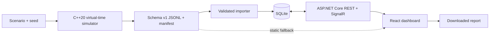
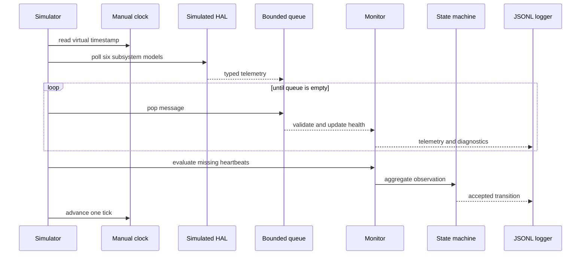
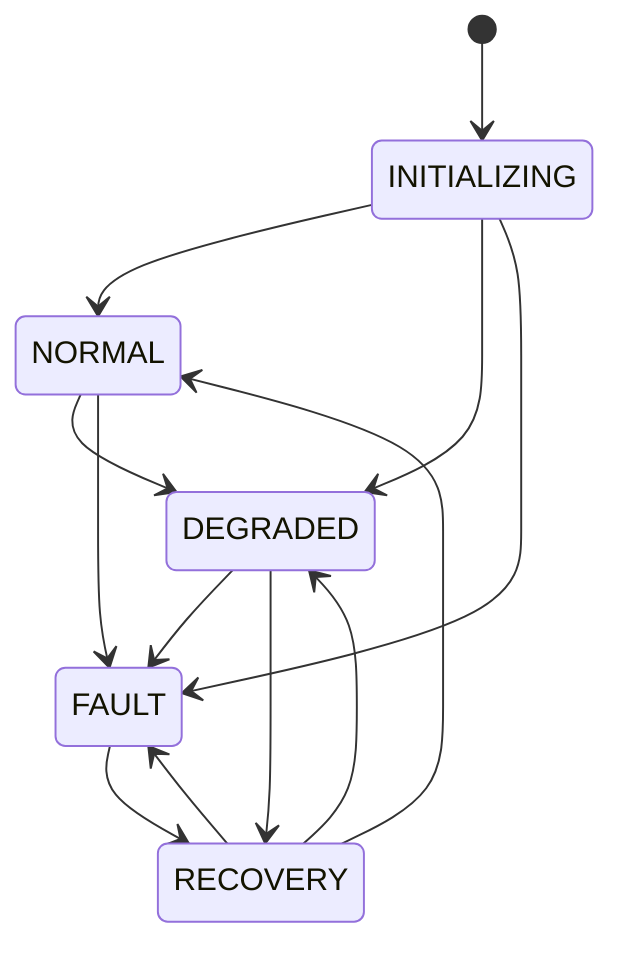

# AeroGuard project guide

This is the single long-form guide for AeroGuard. The root
[README](../README.md) is the portfolio-facing overview; this file contains the
operating instructions, architecture, data contracts, security rules,
requirements, test evidence, design decisions, limitations, and interview
notes.

> AeroGuard is independent educational software. It uses fictional components
> and synthetic data. It isn't connected to aircraft equipment, certified for
> aviation use, or suitable for physical control.

## Contents

- [Run the packaged demonstration](#run-the-packaged-demonstration)
- [Use the dashboard](#use-the-dashboard)
- [Build and run from source](#build-and-run-from-source)
- [Architecture](#architecture)
- [Telemetry, scenarios, and state policy](#telemetry-scenarios-and-state-policy)
- [Security and authorization](#security-and-authorization)
- [Requirements and verification](#requirements-and-verification)
- [Test strategy](#test-strategy)
- [Design decisions](#design-decisions)
- [Limitations and roadmap](#limitations-and-roadmap)
- [Portfolio and interview notes](#portfolio-and-interview-notes)
- [Asset provenance](#asset-provenance)

## Run the packaged demonstration

### Prerequisites

Install Docker Desktop or Docker Engine with Docker Compose v2. Clone the
[AeroGuard repository](https://github.com/dzikidziklasrwie/AeroGuard), then open
a terminal in its root directory.

Copy the environment template:

```bash
cp .env.example .env
```

PowerShell:

```powershell
Copy-Item .env.example .env
```

Open `.env` and replace the example administrator password. Git ignores this
file. Compose synchronizes the configured password at API startup and revokes
older sessions when it changes.

Build and start the integrated stack:

```bash
docker compose up --build
```

The build compiles the C++ simulator, generates seven replay artifacts,
publishes the .NET API, builds React, and starts the API and nginx dashboard.
Wait until both services are healthy, then open:

| Service | Address |
|---|---|
| Dashboard | [http://localhost:8080](http://localhost:8080) |
| Direct API health | [http://127.0.0.1:8081/api/health](http://127.0.0.1:8081/api/health) |
| OpenAPI document | [http://127.0.0.1:8081/openapi/v1.json](http://127.0.0.1:8081/openapi/v1.json) |

Ports 8080 and 8081 bind to loopback. Stop the stack with `Ctrl+C`, then run:

```bash
docker compose down
```

The `aeroguard-data` volume retains SQLite data. `docker compose down
--volumes` removes local accounts, aircraft, assignments, sessions, audit
records, chat, flights, and imported runs.

## Use the dashboard

### Recorded runs

The public replay dashboard needs no account. It loads the REST archive first
and falls back to the seven packaged JSONL files when the API is unavailable.
The selected run starts at virtual time zero, advances automatically, and
returns to the beginning at its recorded end time.

`Public replay scenario` selects the newest run for one scenario. `Recorded runs`
selects an exact archived or bundled artifact. Changing either selection
resets the replay without changing the source file or the signed-in Operations
Workspace session.

These public controls don't assign a scenario to a mapped aircraft. To do
that, sign in, select the aircraft marker or flight-board row, choose a run in
`Change scenario for <tail number>`, and select `Apply scenario`. The tail
number in the label confirms the target before the change is submitted.

The dashboard shows:

| Area | Purpose |
|---|---|
| Overall recorded state | The exact C++ state at the current replay time |
| Subsystem telemetry | The latest visible record for each of six subsystems |
| Telemetry trend | One numeric measurement over simulation time |
| Recorded timeline | Accepted transitions and diagnostic events |
| Simulation statistics | Values from the final C++ summary record |
| Download report | A Markdown report derived from the selected replay |

The browser doesn't evaluate telemetry thresholds or create a second health
decision. It presents the records written by C++.

### Read health information

| State | Meaning |
|---|---|
| `INITIALIZING` | The monitor lacks a complete first assessment. |
| `NORMAL` | All required observations are present and healthy. |
| `DEGRADED` | At least one valid reading crosses a non-critical threshold. |
| `FAULT` | A fault, invalid reading, or required heartbeat loss is active. |
| `RECOVERY` | The problem cleared, but the stability hold has not completed. |

The six subsystem cards represent Power Supply, Cooling System, Temperature
Sensors, Communication Module, Onboard Computer, and Equipment Monitor. A
system fault doesn't overwrite the state of an unrelated healthy subsystem.

Choose a subsystem and numeric metric above the trend chart. The timeline
filters by severity and subsystem and shows the newest 40 matching records at
the current replay position. Statistics come from the final JSONL summary,
not from browser estimates.

### Sign in

Use `Operations workspace` for stored fleet data:

1. Enter the configured username and password.
2. Select `Sign in`.
3. Confirm that the session bar shows the expected account and roles.
4. Select `Sign out` when finished.

The browser holds the bearer token in memory. A refresh removes it. Logout,
password reset, account deactivation, administrator password synchronization,
and expiry revoke the corresponding server session.

### Operations map

The signed-in workspace opens on the world map. Natural Earth geometry ships
with the frontend, so the browser sends no positions or viewport requests to a
map tile provider. Every position, route, and telemetry value is synthetic.

The flight board and markers open a detail rail containing owner, assignment,
coordinates, heading, speed, route scope, selected scenario, six-subsystem
telemetry, chat, and permitted controls. Keyboard users can focus a marker and
press `Enter` or `Space`.

To place a flight, choose an unused `ACTIVE` aircraft, archived run, route
scope, speed from 400 to 1100 km/h, and a start point. Latitude must be from
-85 to 85 and longitude from -180 to 180.

| Scope | Accepted code |
|---|---|
| `WORLD` | `WORLD` |
| `CONTINENT` | `AF`, `AN`, `AS`, `EU`, `NA`, `OC`, or `SA` |
| `COUNTRY` | ISO 3166-1 alpha-3, such as `POL`, `DNK`, or `USA` |

Coordinates set the aircraft's start position. A continent code sets its
destination. The start may be outside that continent: a flight placed in
Russia with `SA` enters `TRANSIT`, follows a great-circle path for no more than
30 seconds, then changes to `PATROL` inside the South America profile. The
detail rail shows the current phase and transit progress. The seven continent
profiles use conservative interior routes, so a Europe patrol doesn't enter
Africa. The country catalog provides bounded presentation routes for supported
codes and uses a local fallback for another valid ISO code. These profiles
don't claim political-border containment.

An administrator can place, reconfigure, or remove any eligible flight. A
non-administrator needs an `OWNER` or `MAINTAINER` aircraft assignment and the
matching operation permission. Only administrators can assign an existing
aircraft to another account. Each aircraft can have one active flight.
Reconfiguration uses the current flight version, so stale writes return HTTP
409. Remove a flight before changing its aircraft from `ACTIVE` or deleting
that aircraft.

Synthetic map motion and scenario playback use separate clocks. The map moves
fast enough to inspect during a short demonstration. Stored C++ telemetry
advances at wall-clock speed and loops after its 40 to 105 second run.

Each marker shows a ground-position shadow linked to an aircraft silhouette,
an always-visible tail number, and a short contrail. The selected-aircraft card
repeats the tail number, display name, assigned scenario, and current map
effect. The run chosen while placing or reconfiguring a flight affects only
that aircraft.

For an active flight, the `Change scenario for <tail number>` control changes
only its recorded run and restarts that scenario. Its dark scenario menu opens
below the control, identifies each run and duration, and marks the current
choice. The API preserves the current position, destination, patrol scope, and
speed. Optimistic concurrency rejects a stale selection instead of overwriting
another user's change.

Communication loss uses three wide signal rings and a red disconnect mark.
Invalid sensor data uses an amber warning. Power fluctuation sends bright arcs
between pulsing nodes, while multiple failures combine smoke and fault pulses.
Recovery uses a green wash, orbit, confirmation mark, and moving particles. The
105-second overheating replay shows a heat halo and rising waves from 10 to 60
seconds. Fire wraps around the aircraft from 60 to 80 seconds, with smoke and
embers, before airframe breakup, descending debris, and impact. Motion holds
at the breakup point for the rest of that replay cycle. Land shows an impact
burst and wreckage. Water shows a splash and floating debris without a second
explosion. These deterministic visuals are fictional presentation states, not
a physics or accident model.

Use `+` and `-` or the mouse wheel to zoom from 1x to 6x. Drag to pan, select
`Reset` for the full world, or select `Focus selected` to center the active
aircraft. Placement clicks use the current zoom and pan position. A completed
drag doesn't place or move an aircraft.

The API keeps rendered output inside latitude -82 to 82 and longitude -176 to
176, including long-running and antimeridian routes. React applies the same
input validation and an edge-safe display projection. If one REST or SignalR
update contains a bad coordinate, the browser keeps the aircraft's last valid
position instead of removing its marker.

`SignalR connected` means the browser receives authorized changes from the
API. After reconnection it reloads the REST snapshot. If SignalR is unavailable,
the map polls REST every five seconds. Event sequence checks reject an older
update received after a newer removal.

`Session demo` means the operations API couldn't load. Its flights and chat
exist only in browser memory. An authentication failure signs the user out
instead of starting this fallback.

### Flight chat

Any active assigned user can read a flight's chat. `CHAT_SEND` permits text and
location messages. Telemetry sharing also requires `OWNER` and
`TELEMETRY_SHARE`; administrators bypass these checks.

Messages accept 1 to 500 characters. The server sets sender and time and builds
location or telemetry payloads from its current flight snapshot. Each active
flight retains its latest 500 messages, and the API returns at most 200 when a
room opens.

### Roles, assignments, and operation permissions

| Role | Application access | Default operation permissions |
|---|---|---|
| `Admin` | All accounts, roles, aircraft, assignments, flights, and audit | Bypasses all five checks |
| `Operator` | Create aircraft; update assigned aircraft as owner or maintainer | All five permissions |
| `Maintainer` | Operate assigned aircraft on the map and update assigned aircraft | All five permissions |
| `Viewer` | Read assigned aircraft | `CHAT_SEND` |

Aircraft assignments apply to one aircraft:

| Fleet label | API level | Access |
|---|---|---|
| `Operator` | `OWNER` | Read and update; at least one owner must remain |
| `Maintainer` | `MAINTAINER` | Read and update the aircraft record; place, reconfigure, and remove assigned map flights |
| `Viewer` | `VIEWER` | Read |

Only an administrator can assign an existing aircraft to another account.
Fleet uses the same visible role names as People and roles and proposes a
matching Fleet role when the administrator selects an account. The stored API
level remains `OWNER`, `MAINTAINER`, or `VIEWER` so authorization rules stay
explicit and backward compatible.

The five account operation permissions are `FLIGHT_PLACE_OWN`,
`FLIGHT_RECONFIGURE_OWN`, `FLIGHT_REMOVE_OWN`, `CHAT_SEND`, and
`TELEMETRY_SHARE`. A saved account override replaces the complete role-default
set. Saving no checked permissions creates an explicit empty override. Custom
roles have no operation defaults.

### Manage aircraft, users, and audit

An administrator or operator can create an aircraft. Tail numbers use 2 to 16
ASCII letters, digits, or hyphens and are unique without regard to case. The
creator becomes the first owner. Aircraft updates use `expected_version`; a
conflict requires a reload before retrying.

Administrators manage assignments, accounts, built-in or custom roles, account
status, passwords, and operation overrides. The API prevents removal of the
last active administrator and the last aircraft owner. Deactivation and
password reset revoke affected sessions.

The audit view shows the latest account, role, session, aircraft, assignment,
operation-permission, and active-flight changes. It supports local review but
isn't tamper-evident.

### Export a report

After a replay loads, `Download report` creates
`aeroguard-<scenario>-report.md`. It contains run metadata, configuration,
statistics, transitions, events, and import warnings.

### Dashboard troubleshooting

| Symptom | Action |
|---|---|
| Port 8080 doesn't open | Run `docker compose ps`; check for a port conflict. |
| API is unhealthy | Run `docker compose logs api`; check `.env` and volume access. |
| Login fails after an `.env` change | Run `docker compose up --detach --force-recreate api`, then use the new password. |
| Dashboard uses bundled data | Confirm `/api/health` succeeds through port 8080. |
| Map shows `REST snapshot` | Check the `/hubs/operations` WebSocket proxy; REST polling continues. |
| Map shows `Session demo` | Restore the API, then sign in again for persisted data. |
| A flight control is hidden | Check the assignment and corresponding account permission. |
| Chat is read-only | The account lacks `CHAT_SEND`, is inactive, or lost its assignment. |
| HTTP 429 is returned | Wait for the one-minute rate-limit window to renew. |
| Aircraft update conflicts | Reload the current version, review it, then retry. |
| Final Admin or owner change fails | Assign a replacement first. |
| Report doesn't download | Allow local downloads and confirm `Artifact loaded`. |

## Build and run from source

### Toolchain

| Tool | Supported path |
|---|---|
| C++ | MSVC 19.3x+, GCC 12+, or Clang 15+ with C++20 |
| Build | CMake 3.24+ and Ninja |
| Frontend | Node.js 20.19+, 22.13+, or 24+ with npm |
| API | .NET SDK 10.0 |
| Packaged demo | Docker Engine with Compose v2 |

CMake can fetch pinned nlohmann/json and GoogleTest releases when compatible
system packages aren't installed, so the first configure may need network
access.

### Native simulator

Linux:

```bash
cmake --preset debug
cmake --build --preset debug
ctest --preset debug --output-on-failure
./build/debug/aeroguard --list-scenarios
```

Windows Developer PowerShell:

```powershell
cmake --preset debug
cmake --build --preset debug
ctest --preset debug --output-on-failure
.\build\debug\aeroguard.exe --list-scenarios
```

Run one reproducible scenario:

```bash
./build/debug/aeroguard \
  --scenario simulated-overheating \
  --seed 42 \
  --duration 45000 \
  --tick 100 \
  --output demo-output/overheating.jsonl
```

| Option | Meaning | Default |
|---|---|---|
| `--scenario <file-or-slug>` | Scenario slug or JSON path | `normal-operation` |
| `--seed <u32>` | Deterministic 32-bit seed | `42` |
| `--duration <ms>` | Override run duration | Scenario value |
| `--tick <ms>` | Virtual step | `100` |
| `--output <file>` | JSONL destination | `output/aeroguard.jsonl` |
| `--scenarios-dir <directory>` | Slug lookup directory | `scenarios` |
| `--list-scenarios` | Print the catalog | n/a |
| `--export-all <directory>` | Export every supplied scenario and manifest | n/a |

Export the packaged dashboard data:

```bash
./build/debug/aeroguard \
  --export-all frontend/public/data \
  --scenarios-dir scenarios \
  --seed 42
```

An identical scenario, seed, duration, and tick produces the same ordered
simulation records.

### Frontend

```bash
cd frontend
npm ci
AEROGUARD_API_TARGET=http://localhost:5080 npm run dev
```

PowerShell sets the target separately:

```powershell
$env:AEROGUARD_API_TARGET = "http://localhost:5080"
npm run dev
```

Quality commands:

```bash
npm run lint
npm run typecheck
npm test -- --run
npm run build
npm audit --audit-level=moderate
```

### API

Set the administrator password outside the repository:

```bash
export AEROGUARD_ADMIN_PASSWORD='Choose-A-Long-Local-Password-42!'
dotnet run --project backend/src/AeroGuard.Api --urls http://localhost:5080
```

PowerShell:

```powershell
$env:AEROGUARD_ADMIN_PASSWORD = "Choose-A-Long-Local-Password-42!"
dotnet run --project backend/src/AeroGuard.Api --urls http://localhost:5080
```

The first start creates the configured administrator, imports the packaged
runs, and creates an ignored local SQLite database. Direct API starts treat the
password as a bootstrap value. Set `AEROGUARD_SYNC_ADMIN_PASSWORD=true` when
runtime configuration should update an existing administrator and revoke old
sessions. Route and configuration details remain in the
[API reference](../backend/README.md).

```bash
dotnet restore backend/AeroGuard.Backend.sln
dotnet build backend/AeroGuard.Backend.sln --configuration Release --no-restore
dotnet test backend/AeroGuard.Backend.sln --configuration Release --no-build
dotnet format backend/AeroGuard.Backend.sln --verify-no-changes --no-restore
```

### Analysis and installation

Linux sanitizer build:

```bash
cmake --preset sanitizers
cmake --build --preset sanitizers
ctest --preset sanitizers --output-on-failure
```

Clang-based analysis:

```bash
cmake --preset debug -DAEROGUARD_ENABLE_CLANG_TIDY=ON
cmake --build --preset debug
```

Install an optimized build:

```bash
cmake --preset release
cmake --build --preset release
cmake --install build/release --prefix ./install
```

## Architecture

### System context



C++ owns telemetry validation, heartbeat decisions, subsystem health, and
state transitions. .NET validates and stores completed artifacts, enforces
access rules, and distributes stored data. React owns presentation and replay
timing. Neither .NET nor React recalculates the core health policy.

### Component boundaries

| Area | Responsibility |
|---|---|
| `include/aeroguard`, `src/core` | Domain types, validation, and state transitions |
| `src/diagnostics` | Subsystem snapshots, heartbeat tracking, aggregate health, and recovery |
| `src/hal` | Fictional hardware-facing contract and simulated adapter |
| `src/simulation` | Virtual clock, seeded generation, scenario timing, and orchestration |
| `src/logging` | Versioned JSONL serialization and manifest output |
| `frontend/src/data` | Strict schema-v1 parsing and recoverable diagnostics |
| `frontend/src/hooks` | Automatic replay and real-time update state |
| `frontend/src/components` | Dashboard and map presentation |
| `backend/.../Import` | Artifact validation and idempotent import |
| `backend/.../Endpoints` | HTTP translation and DTO responses |
| `backend/.../Identity` | Password checks, sessions, roles, and account rules |
| `backend/.../Fleet` | Aircraft, assignments, optimistic versions, and audit |
| `backend/.../Operations` | Flights, synthetic motion, stored telemetry, chat, and SignalR |
| `backend/.../Data` | Parameterized SQLite access and schema setup |

### C++ execution path



The engine executes synchronously so record ordering remains reproducible.
`BoundedQueue` still owns fixed-capacity storage and synchronization. The
reference engine doesn't add worker threads because scheduler-dependent order
would work against this file-based demonstration.

### Pattern and SOLID map

| Pattern or principle | Concrete use |
|---|---|
| Composition root | `run_scenario` creates `JsonLinesLogger` and `Simulator`; defaults select `SimulatedHardware` and `ManualSimulationClock` |
| Dependency injection | `Simulator` receives `ILogSink`, hardware, and clock contracts |
| Finite state machine | `SystemStateMachine` owns the transition allow-list |
| Repository | Identity, fleet, and operations repositories isolate SQLite |
| Application service | Services enforce permissions and invariants outside endpoints |
| Adapter | `SimulatedHardware` implements `IHardwareAbstraction` |
| Snapshot plus event stream | REST supplies state; SignalR supplies sequenced changes |
| RAII and value semantics | Streams, containers, variants, and optionals own resources |

Validation, transition policy, serialization, HTTP mapping, authorization, and
persistence have separate owners. The six concrete subsystem classes satisfy
the same `ISubsystem` contract. `ISimulationClock`, `ISubsystem`, and `ILogSink`
stay narrow; `IHardwareAbstraction` deliberately groups all six reads and is
broader than one subsystem needs. The telemetry `std::variant` is a closed set,
so adding a subsystem forces visitors and serializers to change at compile
time.

### JSONL and archive contract

Every output line is one JSON object with `schema_version`, `record_type`, and
`timestamp_ms`.

| Record | Additional data |
|---|---|
| `metadata` | Scenario, description, seed, tick, duration, and subsystem list |
| `telemetry` | Sequence, subsystem, health, validity, reason, and measurements |
| `event` | Severity, event code, subsystem, and message |
| `state_transition` | Previous state, next state, reason, and severity |
| `summary` | Final state and run counters |

Metadata is first and summary is last. `manifest.json` indexes exported runs.
The API verifies paths, schema, order, and SHA-256, then imports a new artifact
in one transaction while preserving the original replay bytes. The public REST
surface returns run metadata, filtered records, or unchanged JSONL.

### Operations delivery

An authenticated browser loads an authorized REST snapshot, then connects to
`/hubs/operations`. The server emits `flight_updated`, `flight_removed`, and
`message_posted` events. A reconnect reloads the snapshot. Per-flight sequence
numbers stop a delayed event from restoring removed state.

The placement coordinates are the route start. A `CONTINENT` code selects one
of seven destination profiles. `FlightMotion` follows a great-circle transit
for at most 30 seconds, reports `TRANSIT` progress, and then switches to a
bounded `PATROL` inside that profile. `COUNTRY` keeps a small patrol around the
start point; its ISO code is metadata and doesn't imply polygon containment.
All calculated display positions are inset to latitude -82 to 82 and longitude
-176 to 176.

SQLite stores one active flight per aircraft, per-account operation overrides,
and flight messages. The broadcaster checks each session and current access
before delivery. A failure while preparing one flight doesn't stop the rest of
the broadcast cycle.

The one-second broadcaster returns before database access when no SignalR
connection exists. With connected recipients, it loads administrator IDs once
per cycle, checks each session once per recipient lookup, prepares motion and
telemetry once per flight, and reuses that prepared data across authorized
snapshots. The replay dashboard finds the visible record prefix with a binary
search and derives telemetry, transitions, timeline entries, latest values,
and subsystem histories in one pass. The operations map is loaded only after
the authenticated workspace needs it.

The Docker image builds the simulator, replay data, API, and React bundle in
separate stages. nginx serves React, proxies `/api`, and upgrades
`/hubs/operations`. It disables hub access logs because browser WebSocket
transport may put a bearer value in the query string. The API image runs as a
non-root user, and SQLite uses a named volume.

## Telemetry, scenarios, and state policy

All measurements and thresholds are fictional test data. They aren't aircraft
operating limits.

### Telemetry envelope

`TelemetryMessage` carries a `SubsystemId`, virtual timestamp, increasing
sequence, heartbeat flag, and one `TelemetryPayload` variant. Validation
returns structural validity, `HEALTHY`/`DEGRADED`/`FAULT`, and a stable reason
code. Unknown sources, mismatched payloads, missing heartbeat flags,
non-finite values, out-of-domain values, and non-increasing sequences cannot
silently become healthy.

### Validation thresholds

| Subsystem and field | Accepted input | Degraded | Fault |
|---|---|---|---|
| Power `voltage_v` | 18-36 V | `<24` or `>30` | `<21` or `>33` |
| Power `current_a` | 0-120 A | `>80` | `>110` |
| Power `frequency_hz` | 350-450 Hz | `<390` or `>410` | `<370` or `>430` |
| Cooling `coolant_temperature_c` | -60-150 °C | `>80` | `>105` |
| Cooling `fan_speed_rpm` | 0-20,000 rpm | `<2,000` | `<500` |
| Cooling `flow_rate_lpm` | 0-50 L/min | `<4` | `<1` |
| Temperature sensors | -100-250 °C | hottest `>85` or spread `>20` | hottest `>110` |
| Communications link quality | 0-100% | `<65` | `<20` |
| Communications packet loss | 0-100% | `>10` | `>50` |
| Communications connected | Boolean | n/a | `false` |
| Computer CPU load | 0-100% | `>85` | `>98` |
| Computer memory use | 0-100% | `>90` | `>98` |
| Computer watchdog | Boolean | n/a | `false` |
| Equipment active channels | 0-64 | `<4` | `0` |
| Equipment vibration | 0-100 mm/s | `>12` | `>40` |
| Equipment operational | Boolean | n/a | `false` |

Fault rules take precedence over degraded rules.

### Supplied scenarios

| Scenario | Duration | Scheduled condition |
|---|---:|---|
| `normal-operation` | 40 s | None |
| `communication-interruption` | 45 s | Communications missing from 10-22 s |
| `invalid-sensor-data` | 45 s | Invalid temperature input from 10-20 s |
| `simulated-overheating` | 105 s | Sustained temperature overheat from 10-105 s |
| `power-fluctuations` | 45 s | Power fluctuation from 10-26 s |
| `multiple-subsystem-failures` | 55 s | Overlapping communications, cooling, computer, and equipment faults |
| `recovery-after-temporary-failure` | 45 s | Communications missing from 10-18 s |

Fault types include missing or invalid telemetry, overheating, power
fluctuation, cooling failure, computer overload, and equipment failure. Each
fault uses a half-open interval `[start_ms, start_ms + duration_ms)`. Scenario
parsing rejects invalid timing, magnitude, subsystem, and fault names.

### Health state machine



The table is the complete direct-transition allow-list:

| From | To | Trigger |
|---|---|---|
| `INITIALIZING` | `NORMAL` | Complete healthy startup observations |
| `INITIALIZING` | `DEGRADED` | Usable startup with a non-critical condition |
| `INITIALIZING` | `FAULT` | Critical startup condition |
| `NORMAL` | `DEGRADED` | Non-critical condition starts |
| `NORMAL` | `FAULT` | Critical or compounded condition starts |
| `DEGRADED` | `FAULT` | Condition escalates |
| `DEGRADED` | `RECOVERY` | Degradation clears |
| `FAULT` | `RECOVERY` | Critical condition clears |
| `RECOVERY` | `NORMAL` | Healthy target stays stable for the hold |
| `RECOVERY` | `DEGRADED` | Only a non-critical condition remains |
| `RECOVERY` | `FAULT` | Critical condition returns |

Every unlisted direct edge is rejected without changing state. Re-observing the
current state is a no-op. The monitor selects the most severe observation in
this order: fault or invalid/missing input, degradation, normal, then incomplete
startup. The default heartbeat timeout is 500 virtual milliseconds and the
recovery hold is 1,000 milliseconds. A restored heartbeat produces one
`HEARTBEAT_RESTORED` event before its validated health replaces the missing
status.

## Security and authorization

### Access matrix

| Action | `Admin` | Assigned `VIEWER` | `MAINTAINER` | `OWNER` |
|---|---|---|---|---|
| View flight, telemetry, and chat | Every active flight | Assigned aircraft | Assigned aircraft | Assigned aircraft |
| Place aircraft | Any eligible aircraft | Denied | `FLIGHT_PLACE_OWN` required | `FLIGHT_PLACE_OWN` required |
| Reconfigure flight | Any active flight | Denied | `FLIGHT_RECONFIGURE_OWN` required | `FLIGHT_RECONFIGURE_OWN` required |
| Remove flight | Any active flight | Denied | `FLIGHT_REMOVE_OWN` required | `FLIGHT_REMOVE_OWN` required |
| Send text or location | Allowed | `CHAT_SEND` required | `CHAT_SEND` required | `CHAT_SEND` required |
| Send telemetry | Allowed | Denied | Denied | `CHAT_SEND` and `TELEMETRY_SHARE` required |
| Replace account operation permissions | Allowed | Denied | Denied | Denied |

Unassigned users receive not-found responses for another account's flight and
messages. This avoids confirming that the identifier exists.

### Sessions and transport

Login returns a random opaque bearer token. SQLite stores its SHA-256 value,
expiry, account, and revocation time. SignalR may send the token through
`access_token` because browser WebSocket APIs can't set the authorization
header; the authentication handler accepts that query value only for
`/hubs/operations`.

Each connection records its account and session in API memory. Before every
broadcast, the API checks session status and current roles or assignments.
Multiple API replicas would need shared connection coordination and a SignalR
backplane.

### Server-owned data and validation

The server sets message sender, display name, time, and shared payload. Flight
placement validates aircraft status, assignment, permissions, archived run,
scope code, finite coordinates, speed, and uniqueness. Chat insertion repeats
the current account, assignment, and permission predicates in the same SQL
statement as the write, avoiding a check-then-write revocation race.

Fixed-window limits allow 30 login requests per source address per minute, 30
hub negotiations per account, 90 flight writes per account, and 60 chat writes
per account. A public deployment would still need managed TLS and secrets,
backup and restore, service monitoring, an explicit retention policy, and
capacity tests.

## Requirements and verification

The 58 requirement identifiers remain stable even though their former
standalone files were merged here. `Shall` marks required behaviour.

### Simulation and health

| ID | Required behaviour |
|---|---|
| REQ-001 | Identical effective configuration shall produce identical ordered simulation records. |
| REQ-002 | The CLI shall accept a supplied slug or JSON path and reject unknown scenarios. |
| REQ-003 | Seed, duration, and tick shall be configurable. |
| REQ-004 | The simulator shall model all six documented subsystems. |
| REQ-005 | Telemetry shall use typed fields and carry source, sequence, time, health, validity, reason, and measurements. |
| REQ-006 | Invalid telemetry shall be rejected or marked invalid without terminating the run. |
| REQ-007 | A configured heartbeat timeout shall produce diagnostic evidence. |
| REQ-008 | Inter-component delivery shall use a bounded queue with explicit full and empty behaviour. |
| REQ-009 | The simulation loop shall use an injected virtual clock rather than wall-clock sleeping. |
| REQ-010 | Scenario execution shall require no physical hardware. |
| REQ-011 | Overall health shall use the five documented states. |
| REQ-012 | Only allow-listed transitions shall change state. |
| REQ-013 | A subsystem fault shall not stop unrelated healthy telemetry. |
| REQ-014 | Critical or compounded conditions shall enter `FAULT` and create a transition record. |
| REQ-015 | A cleared fault shall pass through `RECOVERY` and its stability hold. |
| REQ-016 | Diagnostic events shall contain time, severity, code, source, and message. |

### Records and dashboard

| ID | Required behaviour |
|---|---|
| REQ-017 | The distribution shall contain the seven documented scenarios. |
| REQ-018 | JSONL shall contain metadata first, ordered records, and summary last. |
| REQ-019 | Every record shall use schema version 1 and the common envelope fields. |
| REQ-020 | `--export-all` shall create one replay per supplied scenario. |
| REQ-021 | Invalid CLI and scenario input shall return an actionable error and non-zero exit code. |
| REQ-022 | React shall present C++ records without recalculating core health. |
| REQ-023 | The dashboard shall show overall state and six subsystem states. |
| REQ-024 | The dashboard shall provide a trend chart and chronological timeline. |
| REQ-025 | Users shall filter diagnostics by severity and subsystem. |
| REQ-026 | Replay shall start automatically, loop at recorded duration, and reset on selection. |
| REQ-027 | The dashboard shall show statistics, architecture, and an exportable report. |
| REQ-028 | Bad or unsupported data shall produce a recoverable visible error. |

### Delivery, archive, and access

| ID | Required behaviour |
|---|---|
| REQ-029 | Native code shall build and test with MSVC and GCC or Clang. |
| REQ-030 | CI shall run native, frontend, API, sanitizer, and static-analysis checks. |
| REQ-031 | Docker shall reproduce data and run the API and dashboard without host SDKs. |
| REQ-032 | Documentation and UI shall state the fictional, educational, non-certified scope. |
| REQ-033 | The API shall validate and import each artifact once by SHA-256 while preserving bytes and order. |
| REQ-034 | Public REST routes shall expose scenarios, runs, replay bytes, and filtered records. |
| REQ-035 | Runtime configuration shall create or synchronize the administrator without source-controlled credentials. |
| REQ-036 | Login shall issue a time-limited opaque token; logout, reset, and deactivation shall revoke sessions. |
| REQ-037 | Admin routes shall protect built-in roles, the final Admin, and the current account. |
| REQ-038 | Administrators shall see all aircraft; other users shall see assigned aircraft. |
| REQ-039 | Authorized users shall create or update aircraft with optimistic versions. |
| REQ-040 | Administrators shall manage assignments while at least one owner remains. |
| REQ-041 | Account, fleet, permission, session, and flight mutations shall create audit records. |
| REQ-042 | Replay shall prefer REST, fall back to packaged data, and keep tokens in memory. |

### Simulated operations

| ID | Required behaviour |
|---|---|
| REQ-043 | The map shall show authorized synthetic flights with route, owner, scenario, condition, and stored telemetry using packaged geometry. |
| REQ-044 | Admins shall see every flight; assigned active users shall see only their flights and chat. |
| REQ-045 | Flight writes shall enforce administrator bypass or owner plus matching permission and rate limit. |
| REQ-046 | Account operation overrides shall replace role defaults and create audit evidence. |
| REQ-047 | One active flight per aircraft shall enforce status, run, coordinate, speed, scope, and version rules. |
| REQ-048 | Synthetic motion shall stay separate from scenario playback; API and browser shall not recalculate C++ health. |
| REQ-049 | REST snapshot plus sequenced SignalR updates shall recover after reconnect, respect later access revocation, and reject delayed state older than an edit or removal. |
| REQ-050 | Chat shall enforce assignment and share permissions, server-owned payloads, length, retention, and rate limits. |
| REQ-051 | Packaged scenarios shall last 40-105 seconds and agree across manifest, importer, and parser. |
| REQ-052 | API failure may enter a labelled memory-only demo; scenario selection shall preserve an authenticated workspace, while authentication failure shall sign out. |
| REQ-053 | Route coordinates shall remain finite and bounded; React shall retain the last valid position for a bad update and keep markers inside the projected world. |
| REQ-054 | A continent code shall select a destination profile. A flight shall transit from any valid start in at most 30 seconds, report phase and progress, then remain within that profile. |
| REQ-055 | The map shall support bounded 1x-6x zoom, pan, reset, focus, and zoom-aware placement without treating a drag as a placement click. |
| REQ-056 | Every simulated flight shall keep an always-visible tail number, linked map shadow, aircraft silhouette, and selected-aircraft identity tied to that flight. |
| REQ-057 | An authorized user shall assign a run directly to one selected flight without changing its destination; that run shall drive only that aircraft's fictional map effects. |
| REQ-058 | Sustained overheating shall show heat until 60 seconds, fire for 20 seconds, breakup, descending debris, and a land impact or water splash without a second explosion over water. |

### Verification snapshot

Observed locally on 2026-11-21:

| Check | Result |
|---|---|
| Native | 45/45 CTest checks passed |
| API | 67/67 xUnit test cases passed; Release build and format verification passed |
| Frontend | 47/47 Vitest tests in 10 files, lint, typecheck, and production build passed |
| Dependency audit | 0 npm vulnerabilities reported |
| Docker/browser | Both containers healthy; authenticated map, nginx WebSocket handshake, and four SignalR frames checked locally |
| Hosted CI | MSVC, GCC, ASan/UBSan, clang-tidy, frontend, API, and Docker jobs passed |

[GitHub Actions run 44854113152](https://github.com/dzikidziklasrwie/AeroGuard/actions/runs/44854113152)
passed on implementation commit `47d38c5`. It includes the continent-routing,
zoom, per-aircraft scenario, API, frontend, sanitizer, analysis, and Docker
checks described above. The exact
commands and tool versions remain in [TASKS.md](../TASKS.md).

Most requirements have direct automated evidence. The current gaps are stated
rather than hidden:

| Requirement | Remaining evidence |
|---|---|
| REQ-041 | Dedicated assertions for every operation-permission and flight audit action |
| REQ-045 | Exhaustion test for the flight-write rate limit |
| REQ-049 | Automated real-WebSocket revocation, broadcaster failure injection, and negotiation-limit exhaustion |
| REQ-050 | Concurrent revocation/write case, retention-cap integration case, and rate-limit exhaustion |

## Test strategy

| Layer | Scope |
|---|---|
| C++ unit | State policy, validation, queue, clock, parsing, and serialization |
| C++ integration | Engine, simulated HAL, scenarios, and JSONL order |
| CLI | Arguments, catalog, one run, and export-all |
| Frontend | Parser, replay, map rendering, permissions, fallback, and reconnect |
| Producer/consumer contract | C++ schema output against TypeScript parsing |
| API integration | SQLite import, REST, identity, fleet, operations, motion, chat, hubs, and audit |
| CI portability | MSVC plus GCC/Clang paths |
| Analysis | ASan/UBSan and clang-tidy |

High-risk tests use exhaustive transition pairs, numeric boundary partitions,
exact queue capacity, virtual-time heartbeat boundaries, repeatable seeded
records, malformed JSONL, stale live events, polar and antimeridian coordinates,
owner/permission combinations, optimistic conflicts, chat authorization, and
revoked sessions. Tests use temporary databases and generated credentials,
never a production database or checked-in password.

Route tests sample every one of the seven continent profiles through 24 hours
of simulated wall time. A separate 50-year elapsed-time case checks that route
coordinates and heading remain finite. Frontend component tests cover
last-valid-position retention, pointer-centered zoom, pan, reset, selected-
aircraft focus, zoom-aware placement, drag suppression, scenario-to-aircraft
effects, and the complete overheating sequence. API motion tests cover a
continuous transit-to-patrol handoff and the overheating hold across a replay
boundary. An application test signs in, changes the top scenario selector, and
confirms that the workspace session remains mounted.

CI evidence rules:

1. Don't call a configured workflow passing until its run completes.
2. Record local OS, compiler or runtime, command, and date.
3. Explain skipped tests instead of counting them as passes.
4. Report coverage only when a named tool measured it.
5. Keep JSONL and dashboard builds as inspectable CI artifacts.

## Design decisions

| ID | Decision | Reason and limit |
|---|---|---|
| DD-001 | Injected virtual time | Instant boundary tests and reproducible records; no hard real-time claim |
| DD-002 | Closed `std::variant` telemetry | Exhaustive typed handling; a new subsystem changes every visitor |
| DD-003 | Compile-time bounded queue | Visible maximum storage and overflow; not lock-free or certified real-time |
| DD-004 | Synchronous orchestration | Stable record order; no concurrent throughput claim |
| DD-005 | JSON Lines boundary | Ordered, readable artifacts; larger and runtime-validated compared with a binary schema |
| DD-006 | Explicit transition allow-list | Rejected edges stay testable; policy changes also update its matrix tests |
| DD-007 | Narrow injected interfaces | Controlled clock and hardware in tests; interfaces add deliberate indirection |
| DD-008 | Lightweight React presentation | Easy-to-follow parser and replay; custom charts retain accessibility work |
| DD-009 | System package then pinned `FetchContent` | Simple setup and package-manager support; first configure may need network access |
| DD-010 | SQLite behind REST | Small local setup and queryable archive; one-instance storage model |
| DD-011 | Revocable opaque sessions | Immediate revocation and no reusable token in the database; every request checks storage |
| DD-012 | Endpoint, service, repository separation | HTTP, policy, and SQL change independently; more mappings in a small application |
| DD-013 | Optimistic aircraft versions | Prevents silent overwrites; clients must handle HTTP 409 |
| DD-014 | Stored telemetry with separate map clock | Readable 40-105 second scenarios and visible motion; marker path is presentation data |
| DD-015 | REST snapshot plus SignalR changes | Complete initial state and reconnect repair; multi-instance use needs shared coordination |
| DD-016 | Assignment plus account overrides | Restricts one account without changing ownership; overrides replace the whole default set |
| DD-017 | Coordinate validation plus SVG clipping | Protects both the data contract and rendered geometry; antimeridian paths reappear at the opposite edge |
| DD-018 | Destination-driven transit and patrol | Coordinates remain the start while a continent code selects a destination; great-circle transit is capped at 30 seconds and conservative patrol profiles are approximations, not political borders |
| DD-019 | Work only for visible records and connected recipients | Idle broadcasts stop before database reads, prepared flight data is reused, replay state is derived in one pass, and the map loads on demand; per-user authorization and the process-local registry still target a small single-instance deployment |
| DD-020 | Scenario-driven presentation state | One pure timeline maps a flight's stored scenario time to deterministic visuals; Natural Earth land detection remains coarse and the effects aren't a physics model |
| DD-021 | Sequence reservation before asynchronous broadcast work | A delayed periodic snapshot keeps its older sequence and can't outrank a newer edit or removal; the sequence remains process-local |

## Limitations and roadmap

### Current limits

- Models and thresholds are fictional and haven't been validated against an
  aircraft or environmental test programme.
- Logical repeatability doesn't prove worst-case execution time,
  schedulability, redundancy, or compliance with DO-178C, DO-254, or ARP4754A.
- The dashboard replays completed records. SignalR selects archived telemetry;
  it isn't a stream from a running embedded target.
- SQLite, opaque sessions, and the connection registry target one API process.
- There is no formal JSON Schema, database migration history, external identity
  provider, multi-factor authentication, refresh-token flow, or distributed
  session invalidation.
- Chat retains the latest 500 messages per active flight until flight removal;
  it has no age-based archive policy.
- The local Docker profile isn't an internet deployment. Public use requires
  managed TLS and secrets, backups, monitoring, retention rules, and abuse and
  capacity tests.
- Hosted CI checks Docker health and SignalR negotiation but doesn't run the
  complete browser WebSocket path.
- Continent routes use conservative polygons or fallback profiles. Country
  routes use a bounded catalog plus a local fallback. Neither claims complete
  coastline, airspace, or political-border containment.
- Great-circle transit and its 30-second cap are presentation behaviour, not a
  flight plan, navigation model, or statement about real aircraft performance.
- Scenario effects use recorded time and coarse Natural Earth land detection.
  Fire, breakup, debris, splash, and impact graphics are not an accident,
  structural, ballistics, or fluid simulation.
- The broadcaster and replay work reductions have automated behaviour tests,
  but the project has no published fleet-scale or browser-frame benchmark.

### Prioritized work

1. Add JSON Schema and producer/consumer compatibility checks.
2. Measure native coverage with documented exclusions.
3. Add property-based telemetry and transition tests plus parser fuzzing.
4. Connect a running C++ producer through a back-pressured local transport.
5. Replace approximate route profiles with versioned geographic geometry when
   political boundary containment becomes a requirement.
6. Benchmark broadcaster query counts, replay processing, browser frame time,
   allocation counts, and native tick distributions on named workloads.
7. Exercise ARM cross-compilation and a constrained post-initialization profile.
8. Sign releases and publish an SBOM.
9. Add database migrations, backup tests, and a PostgreSQL deployment profile.
10. Add OpenID Connect, MFA, and short-lived refresh-token rotation for hosted use.
11. Complete keyboard, contrast, screen-reader, and reduced-motion audits.

A safety-related product would also need a system safety process, independent
requirements baselines and review, configuration control, target hardware
evidence, timing and resource budgets, tool-qualification decisions, and a
certification plan.

## Portfolio and interview notes

### CV entry

AeroGuard - Avionics Health Monitoring Platform | C++20, ASP.NET Core, SQLite,
React, TypeScript<br>
Built a seeded virtual-time simulator for six fictional aircraft subsystems,
with typed telemetry, bounded queues, heartbeat and fault handling, versioned
JSONL diagnostics, a REST archive, role-based fleet management, and a React
world-map dashboard with assigned flights, destination routes, flight chat,
viewport controls, and SignalR updates.
[GitHub](https://github.com/dzikidziklasrwie/AeroGuard)

Evidence-backed bullet options:

- Designed a C++20 simulation core with scoped domain types, `std::variant`
  telemetry, fixed-capacity delivery, injected clock and HAL contracts, and an
  explicit five-state health policy.
- Built an ASP.NET Core API that imports C++ JSONL into SQLite, exposes replay
  history through REST, and manages revocable sessions, roles, assignments,
  operation permissions, active flights, chat, optimistic updates, and audit.
- Connected stored C++ telemetry to React through REST and a packaged fallback,
  then added authorized SignalR updates, great-circle transit, bounded patrol
  profiles, selected-aircraft identity, scenario-linked map effects, and a
  multi-stage Docker stack.
- Reduced repeated work with idle broadcast exits, one prepared snapshot per
  flight, single-pass replay derivation, and an on-demand map module.
- Verified the implementation revision locally with 45 native checks, 67 API
  test cases, and 47 frontend tests. The same revision passed cross-platform
  CI, sanitizers, static analysis, and Docker.

### Architecture explanation

> AeroGuard is a C++20 simulator for six fictional aircraft subsystems. A
> seeded virtual-time engine creates typed telemetry, validates it, tracks
> heartbeats, and applies an explicit five-state policy. It writes versioned
> JSON Lines that a .NET API archives in SQLite. React replays those records and
> displays assigned synthetic flights moving from a selected start to a bounded
> destination patrol; neither layer recomputes the C++ health decision. The
> project uses a fixed-capacity queue, injected clock and hardware contracts,
> transition-matrix tests, cross-platform CMake, CI, sanitizers, and Docker. It
> makes no hard real-time or certification claim.

### Modern C++ points

| Concept | Project example |
|---|---|
| RAII | Streams, containers, locks, and owned collaborators follow scope lifetime |
| Value semantics | Small telemetry records move or copy without hidden shared ownership |
| `enum class` | Subsystem, health, state, severity, and reason codes |
| `std::variant` | Closed typed telemetry payload set |
| `std::optional` | Queue slots and absent pop results |
| Templates | `BoundedQueue<T, Capacity>` declares type and storage bound |
| Interface injection | Clock and simulated hardware can be controlled in tests |
| Chrono types | `SimTime` keeps milliseconds typed at interfaces |
| Synchronization | Queue mutex and condition variables stay beside shared state |

Interview answers should distinguish logical determinism from deadline
determinism, a synchronized bounded queue from a lock-free one, and archived
SignalR presentation from live target communication. Missing heartbeats are
tested by advancing a manual clock, never by sleeping. JSONL was selected for
ordered streaming writes and inspectable artifacts; its trade-offs are size,
runtime checks, and schema-evolution work.

## Asset provenance

| Asset | Source |
|---|---|
| `assets/aeroguard-hero.png` | Original fictional concept art created for this repository on 2026-11-19 without a company logo, proprietary reference image, or real telemetry |
| `assets/dashboard-preview.png` | Unedited 1600 x 1200 Chrome capture of the production Docker dashboard using seed-42 C++ replay data |
| `assets/operations-map-preview.png` | Unedited authenticated Chrome capture of three API-backed flights, packaged geometry, stored C++ telemetry, and a connected SignalR stream |

The screenshot checks ran against healthy local containers. The operations
capture also recorded a completed nginx WebSocket handshake and four received
SignalR frames.
