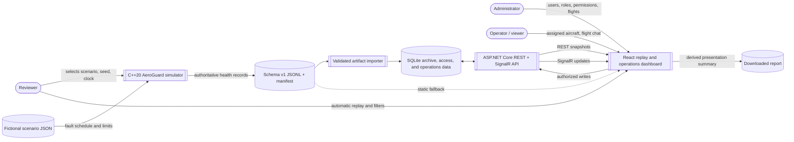
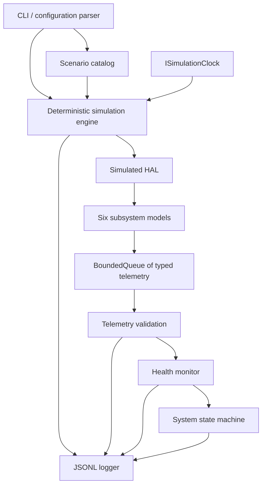
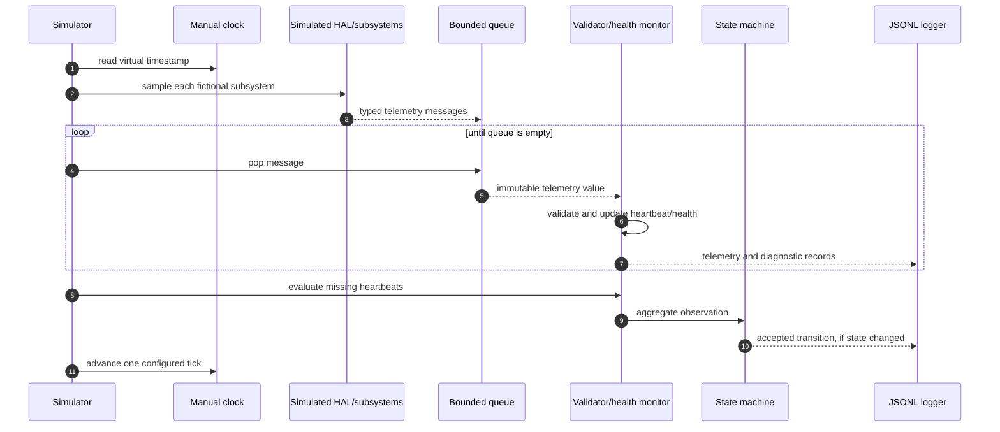
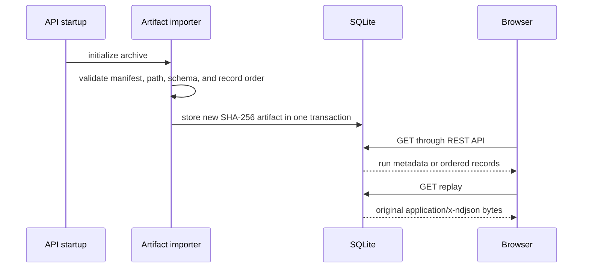
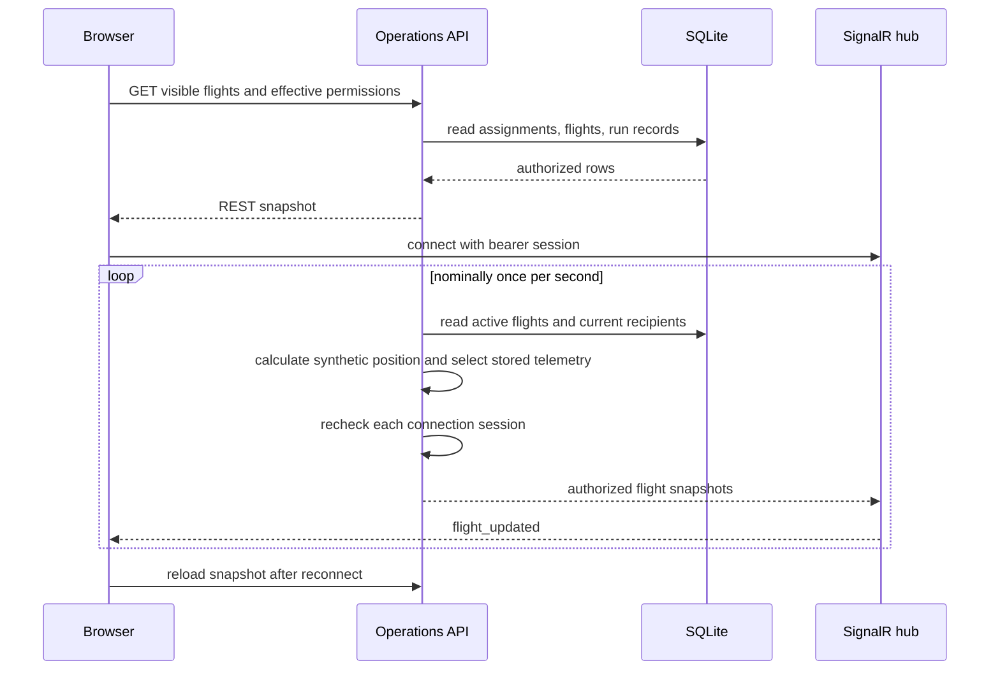
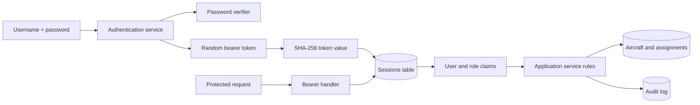
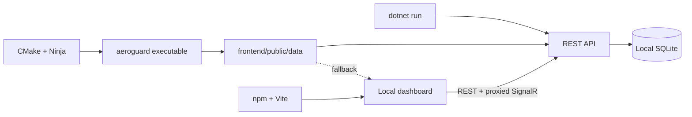

# Architecture

## System context

AeroGuard is a local full-stack educational simulation. A C++20 producer makes
each health decision once and writes versioned JSON Lines. An ASP.NET Core API
validates and archives those artifacts in SQLite. React presents recorded
results and an authenticated world map for simulated flights, accounts, and
aircraft. The API selects stored C++ telemetry for the map but does not
evaluate sensor thresholds or state transitions. React does neither.



The aircraft and subsystems are fictional. There is no connection to an
aircraft, bus, operational network, or proprietary platform.

## C++ component model



| Area | Responsibility | Boundary |
|---|---|---|
| `include/aeroguard`, `src/core` | Domain types, telemetry validation, and allowed state transitions | No UI or file-discovery policy |
| `src/diagnostics` | Per-subsystem snapshots, heartbeat tracking, aggregate health, and recovery timing | Consumes validated domain records |
| `src/hal` | Fictional hardware-facing interface and simulated implementation | Core tests use the simulated HAL instead of hardware |
| `src/simulation` | Virtual clock, seeded subsystem generation, scenario timing, orchestration | No wall-clock delay required |
| `src/logging` | Versioned JSONL serialization and manifest/output handling | Presentation-neutral contract |
| `src/main.cpp` | CLI parsing, composition root, process exit policy | Owns user-facing exception boundary |
| `frontend/src/data` | Strict schema-v1 parsing and recoverable diagnostics | Does not infer new system health |
| `frontend/src/hooks` | Automatic replay cursor and run-reset timing | Source records remain immutable |
| `frontend/src/components` | Engineering dashboard presentation | Reads parsed records only |
| `backend/src/AeroGuard.Api/Import` | Validate manifest and JSONL, then import each artifact once | Rejects unsafe paths and contract mismatches |
| `backend/src/AeroGuard.Api/Endpoints` | HTTP route definitions and DTO responses | Delegates permission and data rules |
| `backend/src/AeroGuard.Api/Identity` | Password checks, bearer sessions, role and account rules | Never returns password or token hashes |
| `backend/src/AeroGuard.Api/Fleet` | Aircraft visibility, assignments, versions, and audit | Does not contain simulation health policy |
| `backend/src/AeroGuard.Api/Operations` | Flight authorization, synthetic map motion, stored telemetry selection, chat, and SignalR delivery | Does not evaluate fictional sensor thresholds or C++ state transitions |
| `backend/src/AeroGuard.Api/Data` | SQLite connection and schema initialization | All values pass through parameters |

## Design principles and pattern map

The project uses named patterns only where the code has the matching boundary.
The table points to concrete types rather than treating a directory layout as
proof of a pattern.

| Pattern or principle | Concrete use | Resulting boundary |
|---|---|---|
| Application composition | `run_scenario` creates `JsonLinesLogger` and `Simulator`; the `Simulator` constructor selects `SimulatedHardware` and `ManualSimulationClock` when no owned alternatives are supplied | Executable composition stays in `main`; default environment choices stay in the `Simulator` constructor |
| Dependency injection | `Simulator` accepts `ILogSink&` plus optional `unique_ptr<IHardwareAbstraction>` and `unique_ptr<ISimulationClock>` dependencies | Simulation orchestration targets contracts while the executable uses explicit defaults |
| Finite state machine | `SystemStateMachine` owns the explicit transition allow-list | Health observations cannot assign an arbitrary overall state |
| Repository | Identity, fleet, and operations repositories implement narrow contracts over parameterized SQLite commands and row mapping | Their service code does not depend on SQL text or connection details |
| Application service | Identity, fleet, and operations services enforce permissions and invariants | HTTP translation and storage mechanics remain separate from policy |
| Adapter | `SimulatedHardware` implements `IHardwareAbstraction`; the six subsystem classes consume that contract | The core has no dependency on a physical device or vendor API |
| Snapshot plus event stream | REST supplies a complete authorized flight set; SignalR supplies sequenced changes | Reconnect reloads the snapshot and stale events cannot restore removed data |
| RAII and value semantics | Streams, containers, variants, optionals, and queue storage own their resources | Core code has no manual `new`/`delete` ownership path |

### SOLID use and limits

| Principle | Project evidence | Deliberate limit |
|---|---|---|
| Single responsibility | Validation, heartbeat aggregation, transition policy, serialization, HTTP mapping, authorization, and persistence are separate components | `Simulator` still coordinates one full tick because record order is part of the contract |
| Open/closed | Scenarios extend behaviour through data, while identity, fleet, and operations storage sits behind repository interfaces | The six telemetry payloads form a closed `std::variant`; a new subsystem must update visitors and serializers so the compiler exposes every affected site |
| Liskov substitution | Six concrete subsystem classes are stored as `unique_ptr<ISubsystem>` and polled through the same `id` and `poll` contract | The subsystem set is closed by `make_subsystems`; adding one also updates the typed payload and serialization contract |
| Interface segregation | `ISimulationClock` and `ISubsystem` expose small cohesive contracts; `ILogSink` groups only simulation record writes | `IHardwareAbstraction` groups all six read operations and is broader than any one subsystem requires |
| Dependency inversion | Simulation policy depends on clock and hardware abstractions, while API services depend on repository contracts | SQLite, JSONL, and SignalR remain concrete choices at their outer adapters |

## One simulation tick



The engine executes this path synchronously to keep record ordering
reproducible. `BoundedQueue` owns fixed-capacity storage and internal
synchronization. If a future producer thread uses the queue, queue indices and
shared mutable state remain private. The reference engine omits concurrency
because extra threads don't demonstrate the health policy.

## State and fault policy

The health monitor tracks the most recent validated observation for every
subsystem and heartbeat age in virtual time. It produces an aggregate
observation; the state machine alone validates state edges. This separates
measurement rules from transition rules and makes both independently testable.

See the complete [state-machine specification](state-machine.md), including
the invalid-transition matrix.

## Data contract

Each output line is one JSON object with these base fields:

```json
{"schema_version":1,"record_type":"telemetry","timestamp_ms":1000}
```

The record variants are:

| `record_type` | Additional contract |
|---|---|
| `metadata` | `scenario`, `description`, `seed`, `tick_ms`, `duration_ms`, `subsystems` |
| `telemetry` | `sequence`, `subsystem`, `health`, `valid`, `reason`, `data` |
| `event` | `severity`, `event_code`, nullable `subsystem`, `message` |
| `state_transition` | `from`, `to`, `reason`, `severity` |
| `summary` | scenario/seed/final state and tick, telemetry, invalid, heartbeat, dropped-message, transition counts |

The logger writes metadata first and summary last. Intermediate records retain
simulation order. The dashboard reports unknown record types and unsupported
schema versions as parse diagnostics. It doesn't interpret them silently.

`--export-all` also writes `manifest.json`, which lists generated replay files
for the dashboard. The manifest indexes files; JSONL contains the detailed
events.

```json
{
  "schema_version": 1,
  "generated_by": "AeroGuard",
  "scenarios": [
    {
      "id": "normal-operation",
      "label": "Normal operation",
      "description": "All six fictional subsystems remain within nominal operating limits.",
      "file": "normal-operation.jsonl",
      "duration_ms": 40000,
      "tick_ms": 100,
      "final_state": "NORMAL"
    }
  ]
}
```

The `scenarios` entries include recorded duration, tick, and final state. The
dashboard identifies a replay through `id`, `label`, `description`, and `file`.

## Archive and REST flow

Startup creates the SQLite schema, imports the seven packaged artifacts, and
uses each source SHA-256 value as the idempotency key. One transaction stores a
run, its ordered records, and the original replay bytes. Public read routes
return run metadata, filtered records, or the unchanged JSONL content.



The dashboard requests `/api/scenarios` first. If no API is reachable during a
static-only demonstration, it loads `/data/manifest.json` and the packaged
JSONL files. Both paths use the same strict parser.

## Simulated operations flow

An authenticated browser loads active flights through REST, connects to
`/hubs/operations`, and receives `flight_updated`, `flight_removed`, and
`message_posted` events. The browser reloads the REST snapshot after a SignalR
reconnection. If the hub cannot connect, it polls the REST snapshot every five
seconds. Per-flight event sequences stop an older delayed update from restoring
a marker after a newer removal.



The route position and scenario clock are separate. `FlightMotion` advances a
synthetic circular route at 120 times the displayed aircraft speed so movement
is visible during a short demonstration. The scenario clock advances at
wall-clock speed, reads the archived C++ telemetry for the matching virtual
tick, and returns to zero after the recorded 40 to 55 second duration. The API
maps recorded subsystem health to a map condition but does not apply sensor
limits or C++ state-transition rules.

SQLite stores one `active_flights` row per aircraft, per-account
`user_operation_permissions`, and `flight_messages`. A flight references one
archived run. A database trigger keeps the latest 500 messages per flight, and
deleting the flight deletes those chat rows. A mapped aircraft must remain
`ACTIVE` until the flight is removed. The map geometry comes from the packaged
Natural Earth `world-atlas` data and requires no map tile service. When the
operations API cannot load, React labels its temporary memory-only state as a
session demo.

The route calculator normalizes longitude at the antimeridian and clamps
latitude to the accepted -85 to 85 range. React validates each REST or SignalR
coordinate again before projection. Its aircraft layer uses the projected
sphere as an SVG clip path, and labels point toward the map center. These two
boundaries prevent malformed updates, aircraft icons, labels, and draft
markers from appearing outside the published world geometry.

Chat authorization and insertion share one SQL statement, so an assignment or
permission cannot be revoked between a separate check and the write. During a
broadcast cycle, an exception for one flight is logged and the broadcaster
continues with the remaining flights.

## Identity and fleet boundaries

Passwords use ASP.NET Core's password hasher. Login creates a random opaque
bearer token, stores only its SHA-256 value, and returns the plain value once.
Every protected request resolves an active, unexpired, unrevoked session.



Built-in roles provide application permissions and operation defaults:

| Role | Account and fleet access | Operation default |
|---|---|---|
| `Admin` | Full management, audit read, and all aircraft | Bypasses all five operation checks |
| `Operator` | Create aircraft; update assigned aircraft as `OWNER` or `MAINTAINER` | All five operation permissions |
| `Viewer` | Read assigned aircraft | `CHAT_SEND` |

Aircraft assignment levels are separate from roles. `OWNER`, `MAINTAINER`,
and `VIEWER` define access to one aircraft. Services protect the final active
administrator and the final aircraft owner. Aircraft updates use an expected
version so concurrent edits cannot silently overwrite each other.

Operation permissions are per-account overrides layered on aircraft
assignments. A non-administrator must hold `OWNER` plus the matching place,
reconfigure, or remove permission. Any active assigned user can view the
flight. Telemetry sharing requires `OWNER`, `CHAT_SEND`, and
`TELEMETRY_SHARE`. Custom roles supply no operation default. See
[Security and authorization rules](security-and-authorization.md) for the
complete matrix and SignalR session checks.

## Ownership and predictability

- `TelemetryPayload` uses `std::variant` over six payload structs. Visitors
  handle every allowed payload without downcasts.
- Tests inject `ManualSimulationClock` through `ISimulationClock` and advance
  virtual time without sleeping.
- `BoundedQueue<T, Capacity>` stores slots in `std::array<std::optional<T>>`,
  which makes capacity and maximum slot storage visible at compile time.
- The composition root creates components at the process edge. Core APIs use
  values and references, while RAII manages streams, containers, and object
  lifetimes.
- Seeded generation and virtual timestamps keep output independent of machine
  speed. This gives logical determinism, not a hard real-time guarantee.

## Deployment views

### Native development



### Docker demonstration

The multi-stage image builds the C++ producer, generates seeded scenario data,
publishes the .NET API, and builds the React bundle. Compose starts an API
container with a named SQLite volume and an nginx container that serves React,
proxies `/api`, and upgrades `/hubs/operations` to WebSocket. nginx disables
access logging for `/hubs/` because the browser transport can put the bearer
token in the query string. The direct API host port binds to
`127.0.0.1:8081`, while nginx binds to `127.0.0.1:8080`. Compose enables one trusted
forwarded-header hop from nginx to the API. The runtime images contain none of
the C++, Node.js, or .NET SDK toolchains. The administrator password enters
through the local environment and is absent from image layers and Git. Compose
synchronizes it with the configured account at API startup and revokes older
sessions when the hash changes.

## Safety and trust boundary

AeroGuard is independent portfolio software. It uses no real aircraft
interfaces, operational parameters, threat data, weapons, countermeasures, or
confidential information. AeroGuard has no certification and makes no claim of
deterministic execution deadlines, airworthiness, or suitability for physical
control.

The connection registry is process memory. This design targets one local API
instance and does not coordinate SignalR connections across replicas.
Recipient-specific snapshot creation is intended for a small demonstrator, not
a distributed or high-volume fleet.
