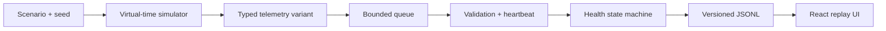

# Learning and interview guide

## A 90-second project explanation

> AeroGuard is an independent C++20 simulator for health monitoring across six
> fictional aircraft subsystems. A seeded, virtual-time engine creates typed
> telemetry, validates it, tracks heartbeats, and applies an explicit five-state
> health policy. It writes versioned JSON Lines that a React dashboard replays;
> the UI never recomputes the core decision. I used a fixed-capacity queue, an
> injected clock and simulated HAL, exhaustive transition tests, cross-platform
> CMake presets, CI, and sanitizers. The project makes no hard real-time or
> aviation-certification claim.

## Architecture story to draw on a whiteboard

C++ owns simulation and health decisions. React owns presentation and automatic
replay timing. The JSONL boundary exposes the records that cross between them,
so tests check that separation directly.

## Modern C++ concepts demonstrated

| Concept | Where to point | How to explain it |
|---|---|---|
| RAII | Streams, containers, simulator-owned collaborators | Scope controls lifetimes, so cleanup doesn't depend on a separate success path. |
| Value semantics | Telemetry structs/messages | Code copies or moves small domain records without a hidden shared owner. |
| `enum class` | Subsystem, health, state, severity, validation code | Scoped enums prevent accidental integer mixing and clarify API intent. |
| `std::variant` | `TelemetryPayload` | A closed, type-safe union replaces an inheritance hierarchy and per-message heap allocation. |
| `std::optional` | Queue slots and pop result | The type represents absence without a magic value or nullable raw pointer. |
| Templates/non-type parameters | `BoundedQueue<T, Capacity>` | Template parameters define the element type and maximum storage at compile time. |
| Move semantics | Queue push/pop | Push and pop transfer ownership without unnecessary deep copies, then reset moved-from slots. |
| Interface injection | `ISimulationClock`, HAL boundary | Tests substitute environment-sensitive behaviour without a global singleton. |
| `[[nodiscard]]` | Validation/conversion/queue APIs | The compiler flags an ignored result that carries failure information. |
| Const correctness | Queries such as `now`, `size`, `closed` | The callable contract states which queries don't modify the object. |
| Chrono types | `SimTime` | Milliseconds are a type, avoiding unitless time arithmetic at interfaces. |
| Thread-safety primitives | Queue mutex/condition variables | The queue keeps synchronization beside the shared state it protects. |

### RAII versus garbage collection

Coming from Java/C#, explain RAII as deterministic lifetime management that
also covers memory reclamation. A destructor runs when its owner leaves scope,
so files, locks, and buffers follow the same rule. Use smart pointers for
dynamic ownership, not as a default replacement for values.

### Why use the variant

`TelemetryMessage` carries exactly one of six payload structs. A visitor handles
the alternatives, and validation checks that `SubsystemId::Power` matches
`PowerTelemetry`. Adding a seventh type changes the closed set and every
exhaustive visitor, which exposes the interface expansion during review.

### What “deterministic” means here

The same scenario configuration, seed, and virtual-clock parameters produce the
same ordered records. It doesn't mean a tick completes by a certified
deadline. Logical determinism and hard real-time timing are separate claims.

## Phased development and self-verification

| Phase | Engineering focus | Verify it yourself |
|---|---|---|
| 1. Toolchain | CMake targets, presets, dependency pinning | Configure `debug`; inspect targets; build with warnings. |
| 2. Domain core | Strong enums, telemetry variant, validation, queue | Run focused GoogleTests; try boundary and mismatched payload cases. |
| 3. Simulation | Injected clock, seeded generation, state policy | Run the same command twice and compare JSONL; change only the seed. |
| 4. Fault scenarios | Heartbeat loss, invalid values, compounded failures, recovery | Inspect event codes and transition order in each exported replay. |
| 5. Quality | Unit/integration tests, invalid input, sanitizers | Run `ctest`; run the Linux sanitizer preset; record actual results. |
| 6. Dashboard | Strict parser, automatic replay state, responsive components | Run Vitest, then inspect normal/fault replays at desktop and mobile widths. |
| 7. Contract integration | C++ export-all manifest and frontend data loading | Regenerate `frontend/public/data`; load every scenario from the selector. |
| 8. Delivery | Windows/Linux CI, analysis, artifacts, Docker | Inspect a real CI run; rebuild Docker without a host toolchain. |
| 9. Documentation | Requirements, decisions, limitations, traceability | Pick three `REQ` IDs and follow each to code and a passing test. |
| 10. Clean verification | Fresh build and demo | Clone to a clean path and follow only the README. |

## Interview questions to rehearse

### Why not use unbounded `std::queue`?

A fixed maximum makes overload visible and prevents silent growth. The policy
must still decide whether to reject, wait, or count a dropped message.

### Why is the queue synchronized if execution is deterministic?

It keeps shared queue state encapsulated for controlled producer/consumer use,
but the reference engine doesn't create threads. Thread-safe does not imply
lock-free or hard real-time.

### How do you test missing heartbeats without slow tests?

Advance an injected manual clock across the exact timeout boundary; never sleep
and hope a scheduler behaves consistently.

### Why JSONL?

JSONL preserves record order, supports line-by-line writes and diffs, gives CI a
readable artifact, and works with the React parser. Its costs are size, runtime
validation, and schema-evolution work.

### How is a fault isolated?

The monitor stores observations and health separately for each subsystem. A
failed source creates diagnostics and affects aggregate policy, but healthy
generators continue. Integration tests assert that their telemetry remains.

### What must happen before calling this production avionics?

Do not call it that. Start from safety/system requirements, target constraints,
certification planning, qualified processes/tools, independent verification,
timing analysis, and real hardware evidence.

## Honest CV wording

> Built AeroGuard, an independent C++20 health-monitoring simulator for six
> fictional aircraft subsystems, with seeded deterministic scenarios,
> typed telemetry, heartbeat/fault handling, an explicit state machine,
> versioned JSONL diagnostics, GoogleTest coverage, and a React replay
> dashboard; packaged with cross-platform CMake, CI, sanitizers, and Docker.

Only retain claims that match the checked-in revision and test results you have
personally run. Do not add a pass count, coverage percentage, performance
number, or CI badge until you observe it.
