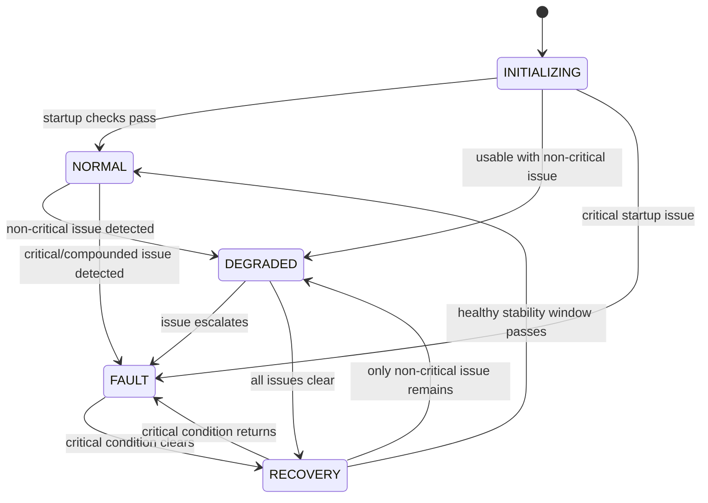

# Health state-machine specification

## Responsibility

The state machine represents system-level health. Each subsystem retains its
detailed health and telemetry. The state machine consumes evaluated conditions,
records policy decisions, and advances only when the simulation engine supplies
an observation.

## State meanings

| State | Meaning | Required operator interpretation |
|---|---|---|
| `INITIALIZING` | Startup observations are not yet sufficient to declare steady health. | Wait for the first complete assessment. |
| `NORMAL` | All required observations are present and within accepted limits. | No action requested. |
| `DEGRADED` | Service continues, but at least one valid subsystem reading crosses a degraded-health threshold. | Inspect diagnostics; unaffected subsystems continue. |
| `FAULT` | A subsystem reports fault health, telemetry is invalid, or a required heartbeat times out. | Treat the simulated system as unhealthy. |
| `RECOVERY` | A prior fault or degraded condition has cleared or improved, but the monitor has not observed stable readings yet. | Continue observing; don't treat it as steady health yet. |

## Transition contract

The table is the complete direct-transition allow-list. A request not listed is
invalid. Re-observing the current condition is a no-op, not a transition, and
must not create a state-transition record.

| From | To | Guard/trigger | Result |
|---|---|---|---|
| `INITIALIZING` | `NORMAL` | Required startup observations are present and healthy. | Enter normal operation. |
| `INITIALIZING` | `DEGRADED` | Startup is usable but has a non-critical condition. | Continue with degraded indication. |
| `INITIALIZING` | `FAULT` | A startup-critical condition is present. | Enter fault. |
| `NORMAL` | `DEGRADED` | A non-critical/tolerated issue becomes active. | Record degradation. |
| `NORMAL` | `FAULT` | A critical issue or configured compound-fault rule becomes active. | Record fault. |
| `DEGRADED` | `FAULT` | A critical issue appears or degradation escalates. | Record escalation. |
| `DEGRADED` | `RECOVERY` | Active degradation clears; recovery observation begins. | Record recovery entry. |
| `FAULT` | `RECOVERY` | No critical condition remains; recovery observation begins. | Record recovery entry. |
| `RECOVERY` | `NORMAL` | Healthy observations remain stable for the configured policy. | Record recovery completion. |
| `RECOVERY` | `DEGRADED` | Critical conditions remain clear, but a non-critical issue persists. | Record partial recovery. |
| `RECOVERY` | `FAULT` | A critical condition recurs before recovery completes. | Record relapse. |

### Explicitly invalid direct transitions

| From | Invalid destinations |
|---|---|
| `INITIALIZING` | `RECOVERY` |
| `NORMAL` | `INITIALIZING`, `RECOVERY` |
| `DEGRADED` | `INITIALIZING`, `NORMAL` |
| `FAULT` | `INITIALIZING`, `NORMAL`, `DEGRADED` |
| `RECOVERY` | `INITIALIZING` |

The transition API shall reject an invalid request, retain its previous state,
and expose failure to the caller. The policy layer may emit a diagnostic event,
but must not serialize an accepted transition for a rejected request.

## Aggregate observation policy

The health monitor evaluates all six snapshots once per virtual tick. It chooses
one desired condition in this order:

| Snapshot condition | Desired state |
|---|---|
| Any subsystem has `FAULT` health | `FAULT` |
| No fault and any subsystem has `DEGRADED` health | `DEGRADED` |
| Every subsystem has `HEALTHY` health | `NORMAL` |
| At least one subsystem has not reported and hasn't timed out | Remain `INITIALIZING` |

The monitor maps invalid telemetry and a non-increasing sequence to subsystem
`FAULT`. With default settings, it also maps a source to `FAULT` after 500
virtual milliseconds without a report and emits one `MISSING_HEARTBEAT` event.
Repeated ticks don't repeat that event. The next message emits
`HEARTBEAT_RESTORED`, then its validated health replaces the missing status.

`MonitorConfig` stores the default 500 ms heartbeat timeout and 1,000 ms
recovery hold as typed values. Focused tests and other compositions supply
alternate timings through the same type.

## Recovery timer

`NORMAL` and `DEGRADED` are recovery targets. Clearing a fault enters
`RECOVERY`; clearing a degraded condition does the same. The monitor starts a
virtual-time hold for the current target:

1. If the target condition remains stable for the full hold, `RECOVERY`
   transitions to that target.
2. If the target changes between normal and degraded, the hold restarts for
   the new target.
3. If any fault returns, the state changes to `FAULT` immediately and cancels
   the hold.

With default 100 ms ticks, a 1,000 ms hold spans ten tick intervals. The check
uses `elapsed >= recovery_hold`, so completion occurs on the boundary.

## Priority and evaluation order

For a single tick, the policy evaluates the most severe current condition:

1. A subsystem fault, invalid reading, or missing heartbeat takes precedence.
2. A non-critical degradation takes precedence over normal health.
3. Recovery policy applies only after the critical condition clears.
4. Normal health applies only when required observations are present.

This ordering prevents record ordering from changing the overall result. Exact
scenario timings and measurement thresholds belong to scenario configuration,
not to the transition graph.

## Records and invariants

Every accepted change adds one JSONL `state_transition` record with the virtual
timestamp, `from`, `to`, reason, and severity. The following invariants apply:

- time never moves backward;
- a record's `from` equals the preceding current state;
- no transition skips the allow-list;
- `FAULT` cannot become `NORMAL` without first entering `RECOVERY`;
- deterministic inputs produce the same transition sequence;
- unrelated healthy subsystems are not reset by a global state change.

See [test strategy](testing.md) for the matrix and scenario-level verification.
