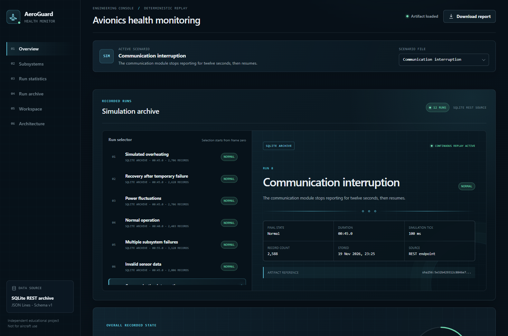
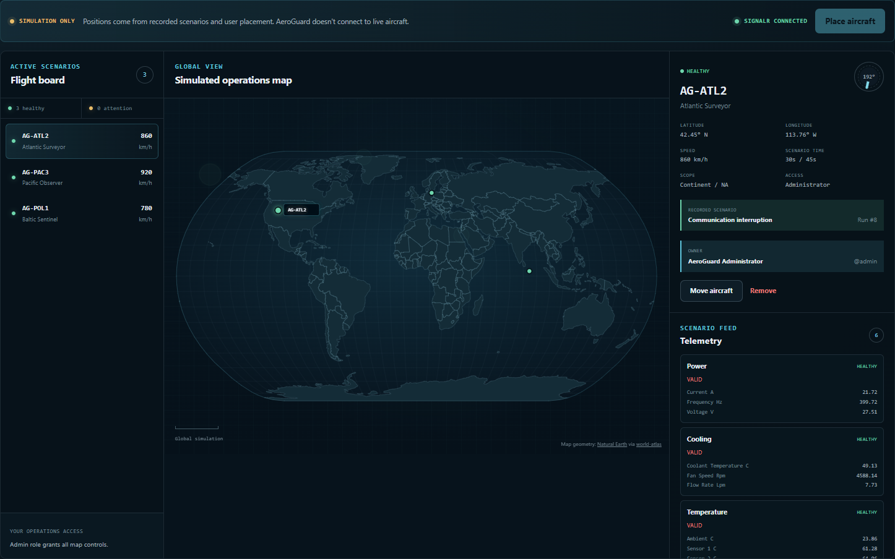

# AeroGuard user manual

## 1. Purpose and scope

AeroGuard demonstrates health monitoring for six fictional aircraft
subsystems. A C++20 application generates synthetic telemetry and records its
decisions as JSON Lines. An ASP.NET Core API validates and archives those runs
in SQLite. The React dashboard replays the records and provides an
authenticated workspace for accounts and aircraft.

This manual covers installation, replay selection, dashboard interpretation,
simulated world-map flights, flight chat, accounts, roles, aircraft
assignments, the native simulator, report export, and common problems.

> AeroGuard is independent educational software. It isn't certified,
> connected to aircraft equipment, or intended for operational use.

## 2. Start the packaged demonstration

### Prerequisites

Install Docker Desktop or Docker Engine with Docker Compose v2. Clone the
[AeroGuard repository](https://github.com/dzikidziklasrwie/AeroGuard), then
open a terminal in its root directory.

### Configure the local administrator

Copy the supplied template:

```bash
cp .env.example .env
```

PowerShell:

```powershell
Copy-Item .env.example .env
```

Open `.env` and replace the example password. The file is ignored by Git. The
default username is `admin`; the plain password is supplied at API startup and
is not written to source control. Compose synchronizes that password with the
configured administrator and revokes older sessions. After a later `.env`
change, recreate the API container before signing in with the new value.

### Build and start

```bash
docker compose up --build
```

The first build downloads base images and dependencies. It then:

1. compiles the C++ simulator;
2. generates all seven seed-42 replay artifacts;
3. publishes the .NET API;
4. builds the React application;
5. starts SQLite, the API, and the nginx dashboard proxy.

Wait for both services to become healthy, then open:

- Dashboard: [http://localhost:8080](http://localhost:8080)
- Direct API health: [http://127.0.0.1:8081/api/health](http://127.0.0.1:8081/api/health)
- OpenAPI: [http://127.0.0.1:8081/openapi/v1.json](http://127.0.0.1:8081/openapi/v1.json)

Compose binds ports 8080 and 8081 to `127.0.0.1`, so dashboard and direct API
access stay on the host. The local profile permits an explicitly selected
short Development password, including `admin`, while direct Production starts
keep the strong-password rule. nginx supplies one trusted hop of forwarded
client information to the API.

Stop the foreground process with `Ctrl+C`, then remove its containers and
network:

```bash
docker compose down
```

The `aeroguard-data` volume keeps the local SQLite database. Run `docker
compose down --volumes` only when you intentionally want to remove all local
accounts, aircraft, assignments, sessions, audit records, and imported runs.

## 3. Dashboard orientation



| Area | Purpose |
|---|---|
| `Scenario file` | Choose the newest recorded run for one of the seven scenarios. |
| `Overall recorded state` | Show the exact C++ state at the current replay position. |
| `Subsystem telemetry` | Show the latest visible record for each of six subsystems. |
| `Telemetry trend` | Plot one numeric measurement over simulation time. |
| `Recorded timeline` | List visible state transitions and diagnostic events. |
| `Simulation statistics` | Show values from the final C++ summary record. |
| `Recorded runs` | Select a specific archived or bundled replay. |
| `Operations workspace` | Sign in to view simulated flights and chat, manage fleet, and, for administrators, manage accounts, roles, permissions, assignments, and audit. |
| `Architecture overview` | Explain C++, JSONL, REST, SQLite, and React boundaries. |
| `Download report` | Export the selected replay as a Markdown report. |

`Artifact loaded` means the dashboard accepted the manifest and selected JSONL
file. The data-source card identifies either the SQLite REST archive or the
bundled C++ files.

## 4. Recorded runs and automatic replay

The selected replay starts automatically. At its recorded end time it returns
to the first record and continues in a loop. The dashboard does not provide
user-operated replay actions.

To change the replay:

1. Find `Recorded runs`.
2. Review source, final state, duration, tick interval, and record count.
3. Select another run.
4. The dashboard resets to virtual time zero and starts the chosen run.

The `Scenario file` selector changes to the newest run for a scenario. The
`Recorded runs` selector can choose a specific entry from the archive. A
selection never changes source records or reruns the simulator.

If the API is unavailable, the same section lists the seven bundled JSONL
files. The dashboard labels that source clearly and applies the same parser.

## 5. Read health information

### Overall states

| State | Meaning in this simulator |
|---|---|
| `INITIALIZING` | The monitor lacks a complete first assessment. |
| `NORMAL` | All required observations are present and healthy. |
| `DEGRADED` | At least one valid reading is outside its nominal range, but no fault rule is active. |
| `FAULT` | A fault, invalid reading, or required heartbeat loss is active. |
| `RECOVERY` | The problem cleared, but the stability hold has not completed. |

`RECOVERY` is distinct from `NORMAL`. A healthy sample does not immediately
erase the recorded fault path.

### Subsystem cards

The six cards represent Power Supply, Cooling System, Temperature Sensors,
Communication Module, Onboard Computer, and Equipment Monitor.

Each card shows the latest visible health, sequence, timestamp, selected
measurements, and a short history line. A system-level fault does not mark an
unrelated subsystem as faulty. This makes isolation visible. An invalid record
remains validation evidence and is never converted into healthy telemetry by
the browser.

### Chart and timeline

Choose a subsystem above `Telemetry trend`, then choose a numeric metric. The
chart begins once at least two samples are visible.

The timeline contains accepted state transitions, diagnostic events, and
heartbeat loss or restoration. Severity and subsystem filters work together.
The newest 40 matching records at the current automatic replay position are
shown.

### Statistics

Statistics come from the final JSONL summary, not from browser estimates. They
include ticks, telemetry packets, invalid packets, missing heartbeats, dropped
messages, and accepted state transitions.

## 6. Supplied scenarios

| Scenario | What to observe | Typical supplied path |
|---|---|---|
| Normal operation | All six sources report within accepted limits. | `INITIALIZING -> NORMAL` |
| Communication interruption | Communications stops while other sources continue. | `INITIALIZING -> NORMAL -> FAULT -> RECOVERY -> NORMAL` |
| Invalid sensor data | Temperature samples fail validation. | `INITIALIZING -> NORMAL -> FAULT -> RECOVERY -> NORMAL` |
| Simulated overheating | Thermal telemetry crosses a fault threshold and later cools. | `INITIALIZING -> NORMAL -> FAULT -> RECOVERY -> NORMAL` |
| Power fluctuations | Power quality crosses a non-critical threshold and stabilizes. | `INITIALIZING -> NORMAL -> DEGRADED -> RECOVERY -> NORMAL` |
| Multiple subsystem failures | Overlapping faults show aggregation and isolation. | `INITIALIZING -> NORMAL -> FAULT -> RECOVERY -> NORMAL` |
| Recovery after temporary failure | A bounded communications failure shows the recovery hold. | `INITIALIZING -> NORMAL -> FAULT -> RECOVERY -> NORMAL` |

The checked-in seed-42 demonstrations finish in `NORMAL`; their timelines keep
the intermediate state history. Changing seed or timing can change values,
while an identical configuration remains deterministic.

## 7. Sign in and session behaviour

Public replay needs no account. Use `Operations workspace` for stored fleet
data.

1. Enter the configured username and password.
2. Select `Sign in`.
3. Confirm the session bar shows the expected account and roles.
4. Select `Sign out` when finished.

The browser keeps the bearer token in memory only. Refreshing or closing the
page removes it. The API stores only a SHA-256 value for each token. Logout,
password reset, and account deactivation revoke affected sessions.

Login is rate-limited. Failure always reports the same username-or-password
message so it doesn't reveal whether an account exists.

## 8. Use the simulated operations map

After sign-in, `Operations map` is the default workspace tab. The map uses
packaged Natural Earth geometry and does not contact a map tile service. Every
position, route, and telemetry value is synthetic.



The left flight board lists visible flights and their current condition. Select
a row or map marker to open its detail rail. A keyboard user can focus a marker
and press `Enter` or `Space`. The rail shows:

- primary owner label and the current account's assignment;
- latitude, longitude, heading, speed, and route scope;
- selected scenario and its looping clock;
- the current six-subsystem telemetry snapshot;
- flight chat and any allowed controls.

The condition tag is a presentation summary of stored C++ subsystem health. It
does not replace the C++ five-state timeline shown by recorded replay.

### Place or move a flight

An administrator can select `Place aircraft` for any `ACTIVE` aircraft. A
non-administrator needs an `OWNER` assignment and `FLIGHT_PLACE_OWN`. Choose an
unused aircraft, one archived run, route scope, speed from 400 to 1100 km/h,
and a starting point. Click the map or type latitude from -85 to 85 and
longitude from -180 to 180.

Scope codes use these rules:

| Scope | Code |
|---|---|
| `WORLD` | The API stores the canonical `WORLD` code; the UI displays `World`. |
| `CONTINENT` | `AF`, `AN`, `AS`, `EU`, `NA`, `OC`, or `SA`. |
| `COUNTRY` | A real ISO 3166-1 alpha-3 code, such as `POL`. |

Only an administrator or an owner with `FLIGHT_RECONFIGURE_OWN` sees the move
control. Only an administrator or an owner with `FLIGHT_REMOVE_OWN` sees the
remove control. Each aircraft can have one active flight. Reconfiguration uses
the visible flight version, so a stale update returns HTTP 409. A mapped
aircraft must remain `ACTIVE` until its flight is removed.

The map position uses accelerated synthetic motion for visibility. The chosen
scenario telemetry advances at wall-clock speed and returns to timestamp zero
after its 40 to 55 second recorded duration. The two clocks are independent.

The API keeps generated coordinates inside latitude -85 to 85 and longitude
-180 to 180. The browser checks the same limits before projection and clips
markers and labels to the world outline. A route that crosses longitude 180
reappears at longitude -180; this is an antimeridian crossing, not a flight
leaving the simulated world.

### Read and send flight chat

Any active user assigned to the aircraft can read its chat. `CHAT_SEND` enables
text and location messages. A telemetry message also requires `OWNER` and
`TELEMETRY_SHARE`. Administrators bypass these checks.

Messages accept 1 to 500 characters. The server sets sender and time and builds
location or telemetry payloads from its current flight snapshot. Each active
flight retains its latest 500 messages until removal. The API returns at most
200 recent messages when the room opens.

### Connection and session-demo states

`SignalR connected` means the browser receives authorized changes from the
API. After a reconnect, it reloads the REST snapshot before continuing. If the
hub cannot connect, the browser refreshes the REST snapshot every five seconds.
Event sequence checks prevent a delayed update from restoring a marker after a
newer removal.
Logout, password reset, deactivation, or session expiry prevents later
delivery on that connection. Role and assignment changes alter which flights
the account receives.

If the operations endpoints are unavailable because of a network, 404, or
server error, the map shows `Session demo`. Its temporary flights and messages
exist only in browser memory. They are not stored API records. An authentication
failure signs the account out instead of starting the session demo.

## 9. Roles, aircraft access, and operation permissions

Roles apply across the application:

| Role | Permissions |
|---|---|
| `Admin` | Manage users, roles, operation permissions, aircraft, assignments, active flights, and audit records. |
| `Operator` | Create aircraft; update aircraft where the account is `OWNER` or `MAINTAINER`; receive all five operation permissions by default. |
| `Viewer` | Read assigned aircraft and receive `CHAT_SEND` by default. |

Aircraft assignment levels apply to one aircraft:

| Level | Permissions |
|---|---|
| `OWNER` | Read and update the aircraft. At least one owner must remain. |
| `MAINTAINER` | Read and update the aircraft. |
| `VIEWER` | Read the aircraft. |

An administrator sees all aircraft even without an assignment. Other users see
only assigned records.

The five account operation permissions are `FLIGHT_PLACE_OWN`,
`FLIGHT_RECONFIGURE_OWN`, `FLIGHT_REMOVE_OWN`, `CHAT_SEND`, and
`TELEMETRY_SHARE`. Aircraft ownership is still required for the three flight
controls and telemetry sharing. `MAINTAINER` does not grant map control.

Role defaults apply only while no override rows exist. In `People and roles`,
an administrator can save the complete permission set for one account. Saving
no checked permissions creates an explicit empty override rather than restoring
role defaults. Custom roles provide no operation permission by themselves.

## 10. Manage aircraft

### Create

An `Admin` or `Operator` can select `Add aircraft`, then provide:

- tail number: 2 to 16 ASCII letters, digits, or hyphens;
- display name;
- model;
- `ACTIVE`, `MAINTENANCE`, or `GROUNDED` status;
- optional notes up to 1000 characters.

The creator becomes the first `OWNER`. Tail numbers are case-insensitive and
unique. When several owners exist, the map labels the earliest assignment as
the primary owner; the assignments panel lists every owner.

### Update

Select an aircraft, edit its fields, and save. The browser submits the visible
revision as `expected_version`. If someone changed the record first, the API
returns a conflict. Refresh the record, review the newer values, and retry. If
the aircraft has an active map flight, remove that flight before changing the
status from `ACTIVE`.

### Assign accounts

Administrators select an active account and an access level, then save the
assignment. Changing or removing the final `OWNER` is rejected until another
owner is assigned.

### Delete

Only an administrator can delete aircraft. Deletion also removes its
assignments. Remove an active map flight first; the API rejects aircraft
deletion while that flight exists. The audit record retains the actor and
deleted aircraft identity.

## 11. Manage users and roles

Administrators can open `People and roles`.

### Create a user

Enter a username, display name, initial password, and at least one role.
Usernames use 3 to 64 ASCII letters, digits, dots, underscores, or hyphens and
start with a letter or digit. Normal passwords use 12 to 128 characters and at
least three character groups.

### Change roles or status

Select role checkboxes and save. The application prevents removal of the final
active `Admin` role. Deactivating an account revokes its sessions. The current
administrator cannot deactivate the account being used.

### Reset a password

Enter a new compliant password on the user card. All current sessions for that
account are revoked.

### Custom roles

Create a role with a name and optional description. Custom roles are labels
until application policy assigns them meaning. Delete is available only when
no user has the role. Built-in roles cannot be deleted.

### Set operation permissions

Use the five operation checkboxes on a user card, then save. The saved set
replaces role defaults for that account. Admin accounts still bypass all five
checks. Permission changes create audit entries.

## 12. Read the audit log

Administrators can open `Audit log` to view the latest 50 changes. Each row has
a timestamp, actor, action, and entity. Recorded actions include login, logout,
bootstrap, user creation, role and status changes, password reset, role
creation or deletion, aircraft changes, and assignment changes.
The log also records operation-permission replacement and active-flight place,
reconfigure, and remove actions.

The log supports review of this local demonstration. It is not a regulated or
tamper-evident audit system.

## 13. Export a replay report

Select `Download report` after an artifact loads. The browser downloads:

```text
aeroguard-<scenario>-report.md
```

The report contains metadata, source artifact, configuration, final
statistics, state transitions, diagnostic events, and import warnings. If no
file appears, allow downloads for `localhost` and try again.

## 14. Run the native simulator

Follow [Build, install, and run](build-and-run.md), then list scenarios:

```bash
./build/debug/aeroguard --list-scenarios
```

Windows Developer PowerShell:

```powershell
.\build\debug\aeroguard.exe --list-scenarios
```

Run one scenario:

```bash
./build/debug/aeroguard \
  --scenario simulated-overheating \
  --seed 42 \
  --duration 45000 \
  --tick 100 \
  --output demo-output/overheating.jsonl
```

| Option | Meaning | Default |
|---|---|---|
| `--scenario <file-or-slug>` | Supplied scenario slug or JSON file path | `normal-operation` |
| `--seed <u32>` | Deterministic 32-bit random seed | `42` |
| `--duration <ms>` | Override scenario duration | Scenario value |
| `--tick <ms>` | Virtual simulation step | `100` |
| `--output <file>` | Destination JSONL path | `output/aeroguard.jsonl` |
| `--scenarios-dir <directory>` | Directory used for slug lookup | `scenarios` |
| `--list-scenarios` | Print the available catalog | Not applicable |
| `--export-all <directory>` | Run every supplied scenario and write a manifest | Not applicable |
| `--help`, `-h` | Print command help | Not applicable |

Export dashboard data:

```bash
./build/debug/aeroguard \
  --export-all frontend/public/data \
  --scenarios-dir scenarios \
  --seed 42
```

Reproduce an output by keeping scenario definition, seed, duration, and tick
interval unchanged. Automatic browser looping never affects simulator data.

## 15. Troubleshooting

| Symptom | Action |
|---|---|
| Port 8080 doesn't open | Run `docker compose ps`; check whether another process uses the port. |
| API is unhealthy | Run `docker compose logs api`; confirm `.env` exists and the data volume is writable. |
| Login fails on a fresh direct API database | Set a password with 12 to 128 characters and at least three of lowercase, uppercase, digits, and symbols. Local Compose also accepts an explicitly selected short Development password. |
| Login fails after changing Compose `.env` | Run `docker compose up --detach --force-recreate api`, then use the new configured password. Startup synchronization revokes the administrator's older sessions. |
| Dashboard labels data as bundled | The API isn't reachable. Confirm `/api/health` succeeds through port 8080. |
| Map shows `REST snapshot` instead of `SignalR connected` | Confirm `/hubs/operations` reaches the API through Vite or nginx. The map keeps polling REST every five seconds. |
| Map shows `Session demo` | The operations API could not load. Temporary map changes are not stored; restore the API and sign in again if needed. |
| `Place aircraft` is unavailable | Use an `ACTIVE` aircraft with an `OWNER` assignment and `FLIGHT_PLACE_OWN`, or sign in as an administrator. |
| A flight control is hidden | Check the current assignment and matching operation permission. `MAINTAINER` can edit an aircraft record but cannot control its map flight. |
| Chat is read-only | The account lacks `CHAT_SEND`, is inactive, or is no longer assigned to the aircraft. |
| An operation returns HTTP 429 | Wait for the one-minute fixed window to renew. Login allows 30 requests per source address; flight writes, chat writes, and hub negotiation allow 90, 60, and 30 requests per account. |
| Scenario manifest cannot load | Generate `frontend/public/data/manifest.json`; use Vite or nginx, not `file://`. |
| JSONL artifact cannot load | Confirm the referenced file exists and uses schema version 1; regenerate edited data. |
| Chart waits for samples | Let the automatic replay advance until two numeric samples are visible. |
| Timeline is empty | Reset severity and subsystem filters and wait for the relevant replay interval. |
| Aircraft update reports a conflict | Another change incremented the version; reload and review before retrying. |
| Final Admin or owner change is rejected | Assign another active administrator or aircraft owner first. |
| Report doesn't download | Allow downloads for the local site and confirm `Artifact loaded`. |
| CLI reports an unknown scenario | Run `--list-scenarios` and check `--scenarios-dir`. |

## 16. Suggested portfolio demonstration

1. Show `Recorded runs` and select Communication interruption.
2. Explain that selection resets the virtual clock and loops automatically.
3. Point out the global `FAULT` while unaffected subsystem cards continue.
4. Filter the timeline to Communication Module and show heartbeat evidence.
5. Show `RECOVERY` before the state returns to `NORMAL`.
6. Sign in and place an owned aircraft on the world map with one recorded run.
7. Show the independent moving marker and looping C++ telemetry clock.
8. Assign a Viewer, send one location message, and explain the difference
   between role defaults, aircraft assignment, and account overrides.
9. Show an operation-permission or flight audit entry and one stale-version
   protection test in the API suite.
10. Finish with the architecture view: C++ decides, JSONL records, .NET
    archives and distributes authorized snapshots, SQLite stores, and React
    presents.

Don't claim aircraft validation, hard real-time behaviour, certification,
production deployment, or a hosted CI pass that hasn't been observed.

## 17. Verification references

[TASKS.md](../TASKS.md) records measured build and test results. The
[traceability matrix](traceability.md) maps each requirement to evidence. The
[API guide](../backend/README.md) documents routes and configuration.
[Security and authorization rules](security-and-authorization.md) records the
map and chat policy.
